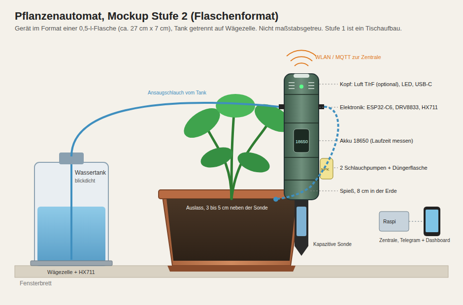
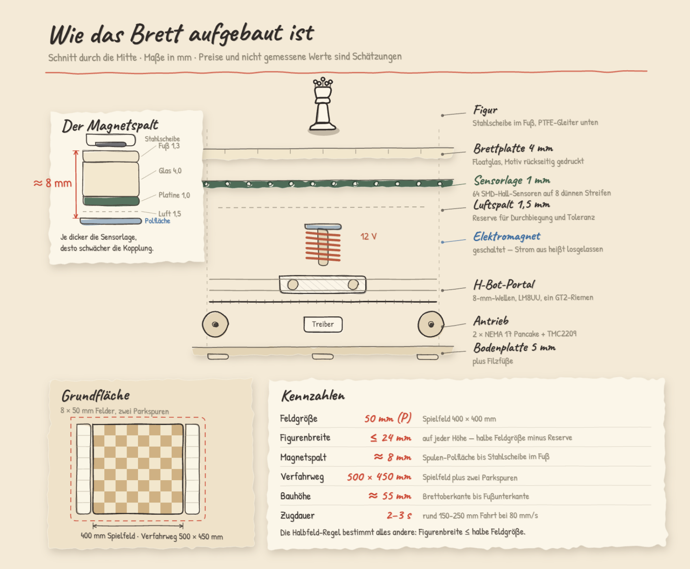

# AI_Bros — Ideensammlung

Hier sammeln wir unsere Projektideen, arbeiten sie so weit aus, dass man sie
vergleichen kann, und **entscheiden uns später für eine**. Hobbyprojekt zu dritt,
Budget 300 Euro, Raspberry Pi ist vorhanden. Doku auf Deutsch.

**Es ist noch nichts entschieden.** Jede Idee liegt in einem eigenen Ordner unter
[`ideen/`](ideen/) und darf unterschiedlich weit gediehen sein.

## Die Ideen

| Idee | Worum es geht | Stand | Budget (Schätzung) |
|---|---|---|---|
| [Pflanzenautomat](ideen/pflanzenautomat/) | Ein Gerät, das eine Zimmerpflanze über Jahre selbstständig gesund hält: Feuchte messen, morgens gießen, nach Plan düngen, Vorräte überwachen, aufs Handy melden | Am weitesten: Spezifikation Stufe 1 v1.2, Meilensteine M0 bis M5 geplant | ca. 293 € |
| [Magnetisches Schachbrett](ideen/schachbrett/) | Ein Brett, das die Züge einer Schach-Engine selbst ausführt — ein Elektromagnet unter dem Brett zieht die Figuren | Mechanik durchgerechnet, Stückliste und Erklärvideo da, nichts gebaut | ca. 248 € |
| [Fenster-Checker](ideen/fenster-checker/) | App zeigt, welche Fenster offen sind; Vorschlag Zigbee-Kontakte + Home Assistant auf dem Pi | Konzept, Varianten und Stückliste | ca. 85 bis 180 € |
| [Besetzt-Lampe](ideen/besetzt-lampe/) | Rot/grün-Lampe vor dem Bad wie im Flugzeug, ohne Kamera und ohne Logging | Konzept, Sensorvarianten und Stückliste | ca. 30 bis 80 € |
| [Jalousien nachrüsten](ideen/jalousien/) | Vorhandene Rollläden/Jalousien motorisieren, Automatik nach Zeit und Sonne | Konzept je Jalousietyp, Typ bei uns noch offen | ca. 35 bis 70 € je Fenster |
| [Topf-Addon (Thermomix light)](ideen/topf-addon/) | Rührwerk, Temperatursonde und Waage mit Rezept-Schrittmodus für normale Töpfe | Konzept, Empfehlung Variante C, Ausbau zu B | ca. 90 bis 225 € (C), bis 310 € (B) |
| [Powermeter](ideen/powermeter/) | Eigener Leistungsmesser am linken Kurbelarm (DMS-Vollbrücke), sendet per BLE an Garmin/Wahoo/Zwift | Konzept, Messprinzip-Skizze, Stückliste | ca. 125 bis 325 € |
| [Gravel-Navi](ideen/gravel-navi/) | Eigenes Fahrradnavi mit Offline-OSM-Karten im Gravel-Stil, Routing am PC mit BRouter | Konzept, Display-Mockup, Varianten A bis D | ca. 165 bis 245 € (Variante A) |
| [WG-Energie](ideen/wg-energie/) *(Vorschlag Claude)* | Zwischenstecker an Großgeräten (Start, Zähler hängt im Keller), Home Assistant, E-Paper im Flur; Zähler-Lesekopf als Ausbau | Konzept, Dashboard-Mockup, [Simulation](ideen/wg-energie/sim/index.html), Annahme: Start mit Variante B | ca. 65 bis 180 € (B), 90 bis 250 € (A) |
| [Smart-Trainer](ideen/smart-trainer/) *(Vorschlag Claude)* | Einfachen Magnet-Rollentrainer zum BLE-Smart-Trainer (FTMS, ERG-Modus) umbauen | Konzept, Prinzip-Skizze, [interaktive Simulation](ideen/smart-trainer/sim/index.html) | ca. 60 bis 110 € |

## Pflanzenautomat

Der Regelkreis Messen → Entscheiden → Dosieren → Überwachen → Melden, in fünf Stufen
vom Tischprototyp bis zur Pilz-Growbox.

- Maßgeblich: [`ideen/pflanzenautomat/docs/00-spezifikation-stufe1.md`](ideen/pflanzenautomat/docs/00-spezifikation-stufe1.md)
- Hintergrund und spätere Stufen: [`ideen/pflanzenautomat/docs/`](ideen/pflanzenautomat/docs/)
- Fortschritt: [`docs/11-meilensteine.md`](ideen/pflanzenautomat/docs/11-meilensteine.md) · Retros: [`docs/13-retros.md`](ideen/pflanzenautomat/docs/13-retros.md)

## Magnetisches Schachbrett

Stockfish rechnet, ein Elektromagnet auf einem H-Bot-Portal führt den Zug aus.
Die bestimmende Regel: gefahren wird nur auf den Linien zwischen den Feldern, dort
ist überall genau ein halbes Feld Platz — also muss jede Figur schlanker sein als
ein halbes Feld.

- Idee: [`ideen/schachbrett/README.md`](ideen/schachbrett/README.md)
- Aufbau, Magnetspalt und Stückliste: [`ideen/schachbrett/aufbau.md`](ideen/schachbrett/aufbau.md)
- Erklärvideo, 59 s: [`ideen/schachbrett/video/`](ideen/schachbrett/video/)
- Mechanik in 3D zum Drehen: [`ideen/schachbrett/3d/`](ideen/schachbrett/3d/)

## Wie wir arbeiten

- Eine Idee bekommt einen Ordner unter `ideen/`, darin eine `README.md` mit der Idee
  selbst und so viel Ausarbeitung, wie sie verdient.
- Preise und nicht gemessene Werte als **Schätzung** kennzeichnen, Platzhalter als **(P)**.
- Offene Entscheidungen stehen bei der jeweiligen Idee und werden nicht stillschweigend getroffen.
- Arbeitsregeln für Claude Code: [`CLAUDE.md`](CLAUDE.md).

Sobald wir uns entschieden haben, wandert die gewählte Idee aus `ideen/` in die
Wurzel und bekommt den Platz, den ein echtes Projekt braucht.
