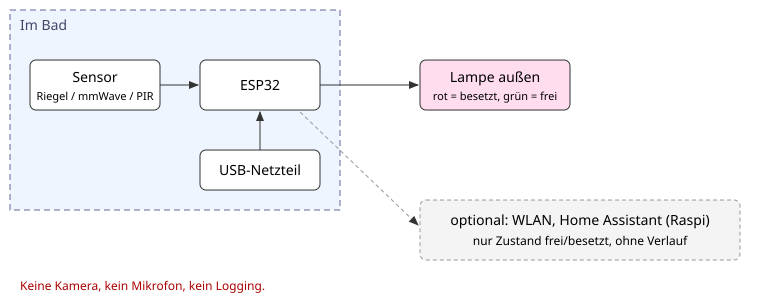

# Idee: Besetzt-Lampe fürs WG-Bad

Stand: 22.10.2026, Vorschlag von Thomas (22.09.). Noch nicht entschieden, eine von mehreren Ideen.

## Idee

Eine Lampe vor dem Bad zeigt wie im Flugzeug an, ob es besetzt ist. Ein Sensor im Bad erkennt
"besetzt", ein Mikrocontroller schaltet die Lampe außen. Kein Klopfen, kein Rütteln an der Klinke.

> **Datenschutz zuerst.** Die Idee wurde im Team als "Spycam" gewitzelt. Gemeint ist nur eine Lampe.
> Darum gilt als Designregel:
> - **keine Kamera, kein Mikrofon**, keine Bildsensoren jeder Art
> - **kein Logging**: der Controller kennt nur den aktuellen Zustand frei/besetzt, nichts wird gespeichert
> - nichts verlässt die Wohnung ohne Zustimmung aller Mitbewohner (kein Cloud-Dienst)
> - jeder in der WG kann den Aufbau ansehen und den Stecker ziehen

## Rahmen

Budget Team 300 €, 3 Leute, Hobbyprojekt, Raspberry Pi vorhanden, Wohnort Karlsruhe.
Mietwohnung: **nichts bohren**, alles kleben, klemmen oder stecken, rückstandsfrei entfernbar.

## Sensorvarianten

| Variante | Prinzip | Vorteile | Nachteile |
|---|---|---|---|
| Riegel- oder Türschlosskontakt | Reed-Kontakt mit Magnet am Riegel, meldet "abgeschlossen" | eindeutig, billig, sehr datensparsam, kein Fehlalarm | nur wenn abgeschlossen wird; Montage am Schloss ohne Bohren fummelig (Klebemagnet) |
| mmWave-Präsenz | Radarsensor erkennt Anwesenheit, auch ruhig sitzend | erkennt Person auch ohne Abschließen und ohne Bewegung | teurer, Reichweite und Störungen (Wand, Dusche) testen; wirkt auf manche "überwachend", gut erklären |
| PIR (Bewegungsmelder) | passiver Infrarotsensor | billig, bekannt, einfach | erkennt ruhiges Sitzen schlecht, Dampf und Wärme können stören, braucht Nachlaufzeit |
| Lichtschalter-Abgriff | Licht im Bad an = besetzt, über Lichtsensor oder Schalterzustand | keine Person wird erfasst | Licht bleibt oft an; Eingriff in die Hausinstallation (230 V) ist in der Mietwohnung tabu, nur ein Lichtsensor kommt in Frage |

Kombination denkbar, z. B. Riegelkontakt plus mmWave. Welche Variante, siehe offene Entscheidungen.

## Empfohlener Aufbau (Vorschlag)

- **ESP32** im Bad (oder im Flur mit Kabel zum Sensor), versorgt über USB-Netzteil
- **Lampe außen** an der Tür: LED-Streifen oder LED-Ring, rot = besetzt, grün = frei, mit Klebepads
- **optional:** Zustand per WLAN an Home Assistant auf dem vorhandenen Raspi, damit man auf dem
  Handy sieht, ob frei ist. Nur der aktuelle Zustand, Verlauf (Recorder) für diese Entität aus.
- Firmware z. B. mit ESPHome. Konkrete Pins erst nach Abgleich mit dem Board-Pinout festlegen.

## Stückliste (Schätzung)

| Posten | ca. € |
|---|---|
| ESP32-Entwicklungsboard | 5 bis 10 |
| Sensor: Reed-Kontakt plus Magnet | 2 bis 5 |
| Sensor alternativ: mmWave-Modul | 5 bis 20 |
| Sensor alternativ: PIR-Modul | 2 bis 5 |
| LED-Ring oder LED-Streifen (adressierbar) | 5 bis 15 |
| Gehäuse (3D-Druck oder fertig), Klebepads, Kabel | 10 bis 20 |
| USB-Netzteil und Kabel | 5 bis 10 |
| **Summe** | **ca. 30 bis 80** |

Alle Preise geschätzt, nicht recherchiert. Bleibt deutlich unter 300 €, Rest für Ersatzteile
und Erweiterungen.

## Meilensteine

1. **M1** Steckbrett: ESP32 plus LED, Lampe schaltet per Taster.
2. **M2** Sensor anschließen, Variante testen, Fehlerquote eine Woche beobachten (ohne Aufzeichnung von Personen, nur Notizen zu Fehlanzeigen).
3. **M3** Gehäuse, Montage ohne Bohren, Lampe außen.
4. **M4** Optional Home Assistant auf dem Raspi, Anzeige am Handy.
5. **M5** WG-Abnahme: alle Mitbewohner sehen den Aufbau und stimmen zu.

## Erweiterungen

- **Warteschlange:** Knopf außen "ich will als Nächstes", Lampe zeigt Wartende.
- **Lüfter:** bei besetzt oder danach eine Weile Lüfter an (nur über Steckdose oder Funksteckdose, kein Eingriff in die Elektrik).
- **Duschzeit-Statistik:** nur anonym und nur mit Zustimmung aller, z. B. Summe pro Woche ohne Zuordnung zu Personen. Widerspricht sonst dem Grundsatz "kein Logging", daher bewusst nur als Erweiterung.

## Offene Entscheidungen

- Welche Sensorvariante, oder Kombination?
- ESP32 allein oder mit Home Assistant auf dem Raspi?
- Lampe: Farben, Helligkeit, nachts gedimmt?
- Stromversorgung im Bad: Steckdose vorhanden und erlaubt, oder Kabel vom Flur?
- Zustimmung der Mitbewohner und ggf. Vermieter einholen, wer macht das?
- Feuchtigkeit: Gehäuse für Badklima (Annahme: außerhalb des Spritzbereichs montieren).

## Mietwohnung

Nichts bohren, nichts an der 230-V-Installation ändern. Montage mit Klebepads oder Klemmen,
rückstandsfrei ablösbar. Beim Auszug alles ab, Wand wie vorher.
