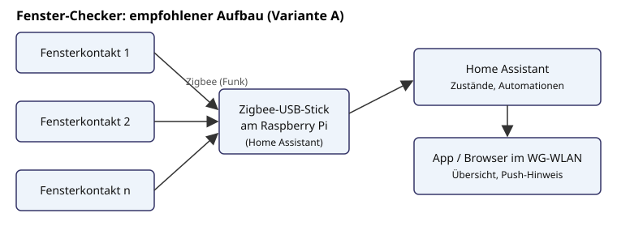

# Idee: Fenster-Checker

Stand: 22.10.2026, Vorschlag von Thomas (22.09.). Noch nicht entschieden, eine von mehreren Ideen.

## Idee

Eine App zeigt, welche Fenster in der WG offen oder zu sind. Sensoren an den Fenstern melden den
Zustand an einen Raspberry Pi (vorhanden), der Pi stellt die Übersicht im WLAN bereit.
Thomas hat eventuell schon Fenstersensoren (Typ und Funkstandard noch klären).
Kevin hat gefragt, ob man die Fenster auch schließen können müsste (siehe Erweiterungen).

Rahmen: 3 Leute, Hobbyprojekt, WG in Karlsruhe, Budget Team 300 €.

## Lösungsvarianten

| | A: Zigbee-Kontakte + Home Assistant auf dem Pi | B: ESP32 + Reedkontakte selbst gebaut | C: Fertiges System (Hersteller-App) |
|---|---|---|---|
| Prinzip | Fertige Funk-Türkontakte, Zigbee-USB-Stick am Pi, Home Assistant zeigt Zustände | Reedkontakt + Magnet am Fenster, ESP32 (z.B. mit ESPHome) meldet per WLAN an den Pi | Kontakte + Hub eines Herstellers, Anzeige in dessen App |
| Kosten (Schätzung) | 60 bis 120 € | 40 bis 100 € | 100 bis 200 € |
| Aufwand | gering bis mittel | mittel bis hoch | gering |
| Bastelanteil | Software, Automationen | Löten, Gehäuse (3D-Druck), Firmware, Stromversorgung | fast keiner |
| Stromversorgung | Knopfzelle in den Kontakten | Akku/Batterie oder Kabel, Deep-Sleep nötig (größte Hürde) | Batterie |
| Thomas' Sensoren nutzbar | wenn Zigbee: ja | nein bzw. nur Reedteile | nur wenn gleiches System |
| Risiko | gering | Batterielaufzeit, Funkreichweite, Montage am Fenster | Cloud-Abhängigkeit, wenig Lernwert |

## Empfohlener Aufbau (Variante A, als Annahme)

Fensterkontakte funken per Zigbee an einen USB-Stick am Pi. Home Assistant läuft auf dem Pi,
speichert die Zustände und bietet App und Weboberfläche im WG-WLAN. Variante A ist als
Ausgangspunkt gewählt, weil sie die vorhandene Hardware nutzt und schnell Ergebnisse bringt.
**(Offen, Entscheidung Team.)** Variante B lässt sich später für einzelne Fenster ergänzen.

## Stückliste (Preise Schätzung)

| Posten | Menge | ca. € |
|---|---|---|
| Raspberry Pi (vorhanden) mit Netzteil, SD-Karte | 1 | 0 bis 15 |
| Zigbee-USB-Koordinator | 1 | 20 bis 35 |
| Zigbee-Tür/Fensterkontakt | 6 bis 8 (P) | 10 bis 15 je Stück, zus. 60 bis 120 |
| Ersatz-Knopfzellen, Klebepads | | 5 bis 10 |
| **Summe** | | **ca. 85 bis 180** |

Fensteranzahl ist ein Platzhalter (P). Konkrete Modelle erst nach Kompatibilitätsprüfung
mit Home Assistant (Zigbee-Integration) auswählen, keine Typen hier festgelegt.

## Schritte / Meilensteine

1. **M1 Bestand:** Fenster zählen, Thomas' Sensoren prüfen (Funkstandard), Pi einsatzbereit machen.
2. **M2 Grundsystem:** Home Assistant auf dem Pi, Zigbee-Stick, ein Kontakt läuft.
3. **M3 Alle Fenster:** Kontakte montieren, Räume benennen, Übersicht in App/Dashboard.
4. **M4 Benachrichtigung:** Push, wenn beim Verlassen der Wohnung Fenster offen sind.
5. **M5 Erweiterungen** nach Lust (siehe unten).

Grobe Zeitschätzung: M1 bis M3 an zwei bis drei Abenden, M4 ein Abend.

## Erweiterungen

- **Fenster schließen (Kevins Frage):** ehrlich bewertet hoher Aufwand und hohes Risiko.
  Normale Dreh-Kipp-Fenster brauchen einen Kettenantrieb oder Kippfensterantrieb, der Griff
  muss trotzdem verriegelt werden. Einklemmschutz ist sicherheitsrelevant (Finger, Haustiere),
  Montage am Rahmen ist in einer Mietwohnung meist nur mit Zustimmung des Vermieters möglich,
  Antriebe sprengen pro Fenster schnell einen großen Teil des Budgets. Empfehlung: höchstens
  ein Kippfenster als Experiment, sonst bei "Anzeigen und Erinnern" bleiben. **(Offen.)**
- **Lüftungserinnerung:** Temperatur/Feuchte-Sensor (Zigbee) ergänzen, Erinnerung bei hoher
  Feuchte oder nach Zeit, Hinweis wenn ein Fenster zu lange offen ist. Wenig Aufwand.
- **Heizung:** Zigbee-Heizkörperthermostate drehen bei offenem Fenster herunter. Mittlerer
  Aufwand, spart Energie, Kosten je Thermostat zusätzlich (Schätzung 25 bis 50 €).
- **Eigenbau-Sensor (Variante B)** für ein Fenster als Lernprojekt.

## Bastelanteil und Lernwert (ehrlich)

Variante A ist überwiegend Konfiguration: Home Assistant, Zigbee, Automationen, etwas YAML.
Hardware wird geklebt, nicht gebaut. Nutzen im Alltag hoch, Bastelanteil gering. Wer löten und
programmieren will, findet das in Variante B oder in den Erweiterungen (Lüftung, Heizung,
Eigenbau-Sensor). Das Grundsystem ist schnell fertig, danach wächst das Projekt nach Bedarf.

## Offene Entscheidungen

- **(Offen)** Variante A, B, C oder Mischung.
- **(Offen)** Welche Sensoren hat Thomas, und lassen sie sich einbinden?
- **(Offen)** Anzahl der Fenster und Räume (gemeinsame Räume, Zimmer nur mit Zustimmung der Bewohner).
- **(Offen)** Fenster schließen: ja als Experiment oder nein.
- **(Offen)** Zugriff von außerhalb der WG (VPN oder nur im WLAN).
