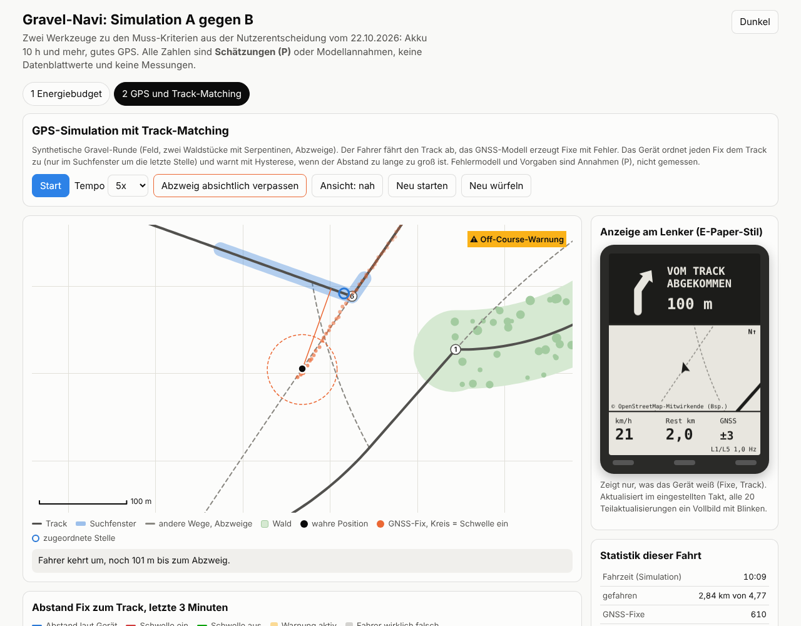
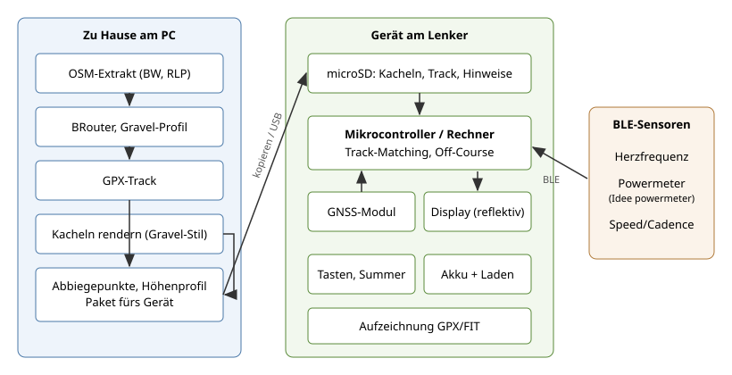
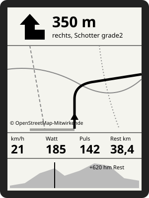

# Idee: Gravel-Navi (eigenes Fahrrad-Navi fürs Gravelbiken)

Stand: 22.10.2026. Eine von mehreren Ideen, ob sie gebaut wird, entscheidet das Team.

> **Nutzerentscheidung (22.10.2026)**
>
> - In Frage kommen nur noch **Variante A (ESP32-S3)** und **Variante B (Raspberry Pi Zero 2 W)**.
>   **C und D scheiden aus.**
> - **Muss-Kriterien:** **Akku 10 h und mehr** und **gutes GPS**.
> - Zwischen A und B ist damit **nicht** entschieden. Der Abschnitt
>   [A gegen B unter den zwei Muss-Kriterien](#a-gegen-b-unter-den-zwei-muss-kriterien) ordnet beide
>   nur unter diesen Kriterien ein. Die Wahl trifft das Team.
>
> Zum Ausprobieren: [Simulation `sim/index.html`](sim/index.html) (Energiebudget A gegen B,
> GPS-Simulation mit Track-Matching und Off-Course-Warnung). Im Browser öffnen, keine Installation.

## Idee

Ein eigenes Fahrrad-Navi, gebaut für das, was wir rund um Karlsruhe fahren: Schwarzwald,
Pfälzerwald, Kraichgau. Also Schotter, Waldwege, Feldwege, Wurzelpassagen und viele kleine
Abzweige, die man auf der Straßennavi-Logik nicht sieht. Das Gerät soll einen vorher
geplanten GPX-Track zuverlässig führen, offline funktionieren und auch bei Sonne lesbar
sein. Rahmen: 3 Leute, Hobby, Budget Team 300 €, Karlsruhe.

## Was ein Gravel-Navi braucht

| Anforderung | Warum | Bemerkung |
|---|---|---|
| GPX-Track folgen | Kern der Sache: geplante Route abfahren | Track als Linie auf der Karte, eigene Position darauf |
| Abbiegehinweise | Im Wald zweigen Wege dicht hintereinander ab | Aus dem Track berechnet (Winkel an Knicken), nicht aus Routing-Anweisungen |
| Off-Course-Warnung | Falsch abgebogen merkt man sonst erst nach 2 km | Abstand zum Track über Schwelle (P) für Dauer (P) |
| Offline-Karten aus OSM | Im Schwarzwald oft kein Netz | Mit Wegtypen: `highway=track`, `tracktype=grade1..5`, `surface=gravel/compacted/ground` usw. |
| Höhenprofil | Kraichgau wellig, Schwarzwald steil | Restanstieg bis Ziel und nächster Anstieg |
| Akku 10+ h | Tagestouren mit Pausen | Ziel 10 h, besser 14 h (P) |
| Ablesbarkeit in Sonne | Kernproblem bei Handys | Reflektive Displays (E-Paper, transflektives LCD) haben hier Vorteile |
| Bedienung mit Handschuhen | Herbst, Winter, Regen | Tasten statt Touchscreen bevorzugt |
| Wasserdicht, vibrationsfest | Schotter rüttelt, Regen | Siehe Gehäuse |
| Aufzeichnung | Fahrt als GPX/FIT speichern | Für Strava/Komoot-Upload später |

Nicht nötig (bewusst weggelassen): Routing auf dem Gerät, Sprachansagen, Social-Funktionen,
Trainingspläne.

## Varianten

C und D sind seit der Nutzerentscheidung vom 22.10.2026 raus und stehen nur noch zur
Nachvollziehbarkeit in der Tabelle.

| | A: ESP32-S3 + Display + GNSS | B: Raspberry Pi Zero 2 W | C: Altes Smartphone + eigene App | D: Handy-App + kleines BLE-Display |
|---|---|---|---|---|
| Was | Eigene Platine/Board, E-Paper oder transflektives LCD, GNSS-Modul, Tasten | Linux-Rechner mit Display und GNSS-Modul | Ausgemustertes Android-Handy, eigene oder angepasste App, Handy fest am Lenker | Handy bleibt in der Tasche und rechnet, ein kleines Display am Lenker zeigt Pfeil, Distanz, Werte |
| Karte | Vorgerenderte Kacheln, einfach, wenig Farbe | Vektor oder Raster, gut möglich | Volle Karte (z. B. Vektor, eigene Stile) | Keine Karte am Lenker, nur Hinweise |
| Ablesbarkeit Sonne | gut (reflektiv) | je nach Display, reflektiv möglich | schwach bis mittel (LCD/OLED, hell = Akku) | gut, wenn Display reflektiv |
| Akku 10+ h | gut erreichbar (Schätzung) | schwierig, Pi braucht dauerhaft Strom | eher nicht ohne Powerbank | Display gut, Handy in Tasche mit GNSS meist ok (Schätzung) |
| BLE-Sensoren | ja (ESP32-S3 hat BLE) | ja | ja (Android BLE) | über das Handy |
| Aufwand Hardware | hoch | mittel | gering | mittel |
| Aufwand Software | hoch (Firmware, Kartenformat selbst) | mittel (Linux, vorhandene Bibliotheken) | mittel (App) | mittel (App + Display-Firmware) |
| Lerneffekt Elektronik | hoch | mittel | gering | mittel |
| Budget 300 € | ja | ja | ja, sehr günstig | ja |

### Ehrlich gegenüber Wahoo, Garmin, Komoot

- **Fertige Geräte** (Wahoo ELEMNT, Garmin Edge) können das alles schon: Karten, Track,
  Abbiegehinweise, Sensoren, 15+ h Akku, wasserdicht, erprobt. Gebraucht oft unter
  150 € zu haben (Schätzung). Rein vom Ergebnis her ist Selbstbauen nicht besser.
- **Komoot/andere Apps** auf dem eigenen Handy lösen Planung und Führung schon gut, Schwachpunkt
  ist Akku und Sonne.
- **Warum trotzdem:** Lernen (GNSS, Displays, Energie sparen, BLE, Kartendaten), eigene
  Darstellung genau für Gravel (Untergrund farbig, `tracktype` sichtbar), keine Abos, und
  Synergie mit dem Powermeter. Erwartung im Team klären: Es wird ein Bastelgerät, kein
  Garmin-Ersatz in der ersten Version.
- **Realistische Messlatte:** Eine Tour im Pfälzerwald, 6 bis 8 h, mit dem Gerät als
  einziger Navigation, ohne dass jemand das Handy zücken muss.

## A gegen B unter den zwei Muss-Kriterien

Nur die zwei Kriterien aus der Nutzerentscheidung: **Akku 10 h und mehr**, **gutes GPS**.
Andere Punkte (Aufwand, Lerneffekt, Karte) sind hier bewusst weggelassen. Alle Zahlen sind
Schätzungen oder Annahmen, keine Datenblattwerte und keine Messungen.

**Simulation:** [`sim/index.html`](sim/index.html), eine Datei, läuft offline im Browser, auch am Handy.

1. **Energiebudget A gegen B:** Leistung je Komponente (SoC/MCU, Display mit Aktualisierungstakt,
   Licht, GNSS-Modus, BLE, Sonstiges, Wandlerverlust) als editierbare Schätzwerte in mW, Akku in mAh
   und Wh, Temperatur-Faktor. Balken für Leistung und Laufzeit, rote Linie bei 10 h.
2. **GPS-Simulation:** synthetische Gravel-Runde mit Feld, zwei Waldstücken, Serpentinen und Abzweigen.
   Einstellbar: Einband oder Mehrband, Wald-Multipath-Faktor, Aktualisierungsrate, Suchfenster,
   Off-Course-Schwellen mit Hysterese und Haltezeit, Display-Takt. Daneben die Anzeige im E-Paper-Stil.
   Knopf "Abzweig absichtlich verpassen", Statistik zu Fehlalarmen und Erkennungszeit, und
   "20 Fahrten durchrechnen" zum Einstellen der Schwellen.

Die Matching-Logik in der Simulation (`matchStep`) ist schon als reine Funktion ohne I/O geschrieben,
so wie sie für M1 gedacht ist. Sie ist ein Entwurf zum Spielen und ersetzt M1 und die Messfahrt nicht.

### Kurzfassung

| Kriterium | A: ESP32-S3 | B: Raspberry Pi Zero 2 W | Bemerkung |
|---|---|---|---|
| Gutes GPS | hängt an GNSS-Modul, Antenne, Einbau | genauso | Beide hängen am selben Modul (UART). Das Kriterium trennt A und B kaum. Es wird durch Modulwahl (Einband oder Mehrband), Antenne und Einbau entschieden, und durch die Software (Track-Matching, Hysterese). |
| Akku 10 h und mehr | mit ca. 1000 bis 1300 mAh rechnerisch erreichbar, mit 2500 mAh viel Reserve (Schätzung) | mit 2500 mAh nicht erreicht (ca. 5 bis 7 h), braucht ca. 3500 bis 5000 mAh je nach Temperatur (Schätzung) | Bestimmend ist die Grundlast des Rechners. Zahlen siehe unten, alles erst nach Messung belastbar. |

### Gutes GPS

Was wir mit "gutem GPS" meinen: im Wald auf dem richtigen Weg bleiben und einen verpassten Abzweig
schnell merken, **ohne Fehlalarme**. Zentimeter sind egal. Was stört, sind Ausreißer und Sprünge
von einigen zehn Metern (Schätzung) unter Bäumen und in Tälern.

**Mehrband L1/L5 gegen Einband L1**

| | Einband L1 | Mehrband L1/L5 |
|---|---|---|
| Frequenzen | GPS L1, Galileo E1 (1575,42 MHz), je nach Modul weitere | zusätzlich GPS L5, Galileo E5a, BeiDou B2a (1176,45 MHz) |
| Multipath (Reflexionen an Stämmen, Hängen) | L1 C/A hat 1,023 MChip/s, Umwege lassen sich schlechter vom direkten Signal trennen | L5/E5a hat 10,23 MChip/s, also zehnfach. Umwegsignale lassen sich besser trennen. Wie viel das im Wald bringt: **messen** |
| Ionosphäre | nur über Modell | aus zwei Frequenzen schätzbar. Im Wald ist Multipath vermutlich der größere Posten (Annahme) |
| Abschattung durch Blätterdach | schwaches Signal | ebenso schwach, Mehrband macht gedämpfte Signale nicht stärker |
| Einschränkung | | L5 senden nur die neueren GPS-Satelliten, nicht alle. Galileo sendet E5a. Mehrband lohnt sich also vor allem zusammen mit Galileo |
| Strom, Preis | weniger | mehr Strom und teurer, Modul und Antenne (Größenordnung, Zahlen aus Datenblatt) |

Kandidaten zum Prüfen, keine Festlegung: Massenmarkt-Module mit L1/L5, z. B. u-blox NEO-F10N oder
die Quectel-LC29H-Familie. Im Datenblatt prüfen: Stromaufnahme je Modus, welche Systeme gleichzeitig,
Schnittstelle, Antenneneingang (aktiv/passiv), Energiesparmodi, Backup-Versorgung für schnellen Start.

**Mehrkonstellation**

- GPS, Galileo, BeiDou (und GLONASS) gleichzeitig heißt mehr Satelliten. Das zählt vor allem in engen
  Tälern (Murgtal, Pfälzerwald), wo der Hang einen Teil des Himmels verdeckt: Die Geometrie bleibt
  besser, und der Empfänger kann schlechte Signale eher verwerfen.
- Welche Systeme ein Modul **gleichzeitig** empfängt, steht im Datenblatt, nicht jedes kann alle auf einmal.
  Galileo ist für uns gesetzt (wegen E5a), GPS sowieso.
- SBAS/EGNOS bringt fürs Track-Folgen vermutlich wenig (Annahme).

**Antenne: Größe und Patch**

- Keramische Patch-Antennen gibt es in gängigen Baugrößen von etwa 12 bis 25 mm Kantenlänge
  (Schätzung, je Hersteller). Größerer Patch auf größerer Massefläche: mehr Gewinn, hilft bei
  schwachem Signal im Wald. Chip-Antennen sind klein, aber schwächer (Annahme, messen).
- Mehrband braucht eine Antenne für **beide** Bänder. Eine reine L1-Antenne am Mehrband-Modul
  verschenkt den Vorteil. L1/L5-Antennen sind meist größer oder gestapelt und teurer (Schätzung).
- Einbau: Antenne flach nach oben, nicht unter Display-Platine, Akku oder Metall. Abstand zu
  Störquellen: Rechner, WLAN/BLE-Funk, Schaltregler, Display-Treiber. Der Fahrer schattet nach
  hinten ab, das lässt sich nicht vermeiden.
- **A gegen B:** Platz für einen großen Patch ist bei beiden. Bei beiden sitzt ein Funk-SoC mit
  schnellen Takten neben der Antenne. Ob das stört, zeigt nur eine Messung: Signalstärke (C/N0) im
  Modul mit Rechner an und aus vergleichen.

**Waldabschattung im Schwarzwald**

- Nadelwald (Fichte, Tanne) dämpft das ganze Jahr, Laubwald im Sommer mehr als im Winter. Nässe
  dämpft zusätzlich (Annahme, nicht gemessen).
- Schwierigster Fall: Wald plus steiler Hang, also wenige Satelliten und Reflexionen am Hang.
- Folgerung: Die Hardware allein löst das nicht. Die Software muss es aushalten: Suchfenster um die
  letzte Stelle, Off-Course nur mit Schwelle, Haltezeit und Hysterese, Plausibilität bei Sprüngen.
- **Messplan (M3):** Ein Einband- und ein Mehrband-Modul gleichzeitig am Lenker, Rohdaten aufzeichnen
  (NMEA, wenn möglich mit Satellitenzahl und C/N0). Erst Hardtwald, dann ein Stück Murgtal. Am PC
  gegen den geplanten Track auswerten: Abstand, Ausreißer, Fehlalarme bei den Schwellen (P).

**Was die Simulation dazu zeigt** (selbst gewähltes Fehlermodell, keine Aussage über echte Module):
Mit den Vorgaben (Mehrband, Wald-Faktor 3, Schwelle 40/25 m, Haltezeit 8/4 s, 1 Hz) gab es in
20 Fahrten keinen Fehlalarm, jeder verpasste Abzweig wurde nach knapp 20 s bzw. 80 bis 100 m erkannt.
Mit Einband und Wald-Faktor 5 kamen Fehlalarme und Sprünge im Fortschritt dazu. Kürzere Haltezeit
oder niedrigere Schwelle erkennt schneller, bringt aber mehr Fehlalarme. Ein großes Suchfenster
lässt die Zuordnung in den Serpentinen auf den falschen Schenkel springen. Die echten Werte für
Schwelle und Haltezeit bleiben (P) bis zur Messfahrt.

### Akku 10 h und mehr

**Rechner, der bestimmende Posten**

- **A:** Der ESP32-S3 kann zwischen den Fixen in einen Schlafmodus gehen, BLE-Verbindungen zu
  Sensoren sollen dabei bestehen bleiben (im Datenblatt und an echter Hardware prüfen). Mittlere
  Leistung im Rechner angesetzt mit 0,1 W (Schätzung, P).
- **B:** Auf dem Pi Zero 2 W läuft Linux dauerhaft, einen Schlafmodus, in dem die Anwendung
  weiterläuft, gibt es praktisch nicht. Grundlast Größenordnung 0,5 bis 1 W (Schätzung aus
  Erfahrungsberichten, kein Datenblattwert), beim Rechnen mehr. Dazu braucht der Pi 5 V: Der
  Hochsetzsteller von der Li-Ion-Zelle kostet zusätzlich (Wirkungsgrad angesetzt 85 bis 90 %,
  Schätzung). Sparhebel, Wirkung unbekannt und zu messen: WLAN, HDMI und LED aus, CPU-Takt
  begrenzen, Kerne abschalten, kein Desktop.

**Rechenbeispiel mit den Vorgaben der Simulation** (alles Schätzung P; E-Paper, Mehrband-GNSS,
2 BLE-Sensoren, ohne Licht, 85 % nutzbare Kapazität):

| | A: ESP32-S3 | B: Pi Zero 2 W |
|---|---|---|
| Leistung am Akku | ca. 0,29 W | ca. 1,1 W |
| Laufzeit mit 2500 mAh (3,7 V), 20 °C | ca. 27 h | ca. 7 h |
| Laufzeit mit 2500 mAh, 0 °C (Faktor 0,85, P) | ca. 23 h | ca. 6 h |
| Akku für 10 h bei 20 °C | ca. 920 mAh | ca. 3450 mAh |
| Akku für 10 h bei 0 °C | ca. 1080 mAh | ca. 4060 mAh |
| Akku für 10 h bei -10 °C (Faktor 0,70, P) | ca. 1310 mAh | ca. 4930 mAh |

Für B heißt das: zwei Zellen statt einer oder ein Akku im Powerbank-Format, mit Folgen für Gewicht,
Gehäusegröße und Halterung. Für A ist der GNSS-Empfänger nach dem Rechner der größte Posten, Mehrband
statt Einband kostet dort spürbar Laufzeit, bleibt nach Schätzung aber deutlich über 10 h.

**Display-Typen**

| Typ | Strom | Sonne | Wald, Dämmerung, Nacht | Kälte | Bemerkung |
|---|---|---|---|---|---|
| E-Paper | fast nur beim Umschalten, Mittelwert hängt am Takt der Teilaktualisierung | sehr gut | ohne Licht schlecht | wird langsamer (Datenblatt) | Ghosting, gelegentlich Vollbild nötig |
| Memory-LCD (MIP), reflektiv | sehr gering, Pixel halten ihren Zustand (Schätzung) | gut | nur mit Frontlicht | Datenblatt | schnell genug für flüssige Anzeige, kleine Größen, teurer |
| Transflektives TFT | Grundlast höher als MIP (Schätzung) | gut | mit Hintergrundlicht gut | Datenblatt | Licht nur bei Bedarf einschalten |
| TFT/IPS mit Hintergrundlicht | Licht dauernd an, dominiert das Budget (Schätzung) | schwach | gut | Datenblatt | passt nicht zu den Muss-Kriterien |

Der Display-Typ trennt A und B nicht, beide können dasselbe SPI-Display ansteuern. Bei A ist er ein
spürbarer Anteil am Budget, bei B geht er neben der Grundlast des Pi fast unter. Licht (Nacht, dunkler
Wald) ist in den Vorgaben nicht eingerechnet und lässt sich in der Simulation über "Licht an, Anteil"
dazunehmen.

**Messplan:** sobald ein Brettaufbau steht (M3), mit USB-Leistungsmesser eine Stunde Fahrbetrieb
(GNSS an, Display im Takt, BLE verbunden) messen und die Werte in die Simulation eintragen. Für B
zusätzlich: Wirkung der Sparhebel einzeln.

### Was das für die Wahl heißt

Keine Entscheidung, nur Einordnung unter den zwei Kriterien:

- **Gutes GPS** ist für A und B gleich gut erreichbar. Die eigentlichen Entscheidungen sind
  Einband oder Mehrband, Antenne und Einbau, und die lassen sich unabhängig von A/B treffen (offen).
- **Akku 10 h und mehr** erfüllt A nach Schätzung mit großem Abstand. B erfüllt es nur mit deutlich
  größerem Akku, belastbar erst nach Messung der Grundlast.

## Aufbau

Zweiteilung: Alles Schwere (Routing, Kartenaufbereitung) passiert am PC zu Hause. Das Gerät
am Lenker bekommt fertige Daten (Track, Kacheln, Höhenprofil, Abbiegepunkte) und muss nur
noch anzeigen, Position bestimmen und vergleichen.

## Bildschirm (Entwurf)

Entwurf für die Fahransicht: oben nächster Hinweis groß, Mitte Kartenausschnitt mit Track
und Untergrund, unten Werte (Geschwindigkeit, Leistung, Puls, Restdistanz) und Höhenprofil.
Schwarz-weiß gedacht, damit es auch auf E-Paper oder einfarbigem transflektivem LCD funktioniert.
Untergrund wird durch Linienstil (durchgezogen, gestrichelt, gepunktet) statt Farbe unterschieden.

## Software

### Kartenkacheln: Vektor oder Raster

| | Raster vorgerendert | Vektor auf dem Gerät gerendert |
|---|---|---|
| Prinzip | Am PC aus OSM fertige Bilder je Zoomstufe erzeugen | Gerät bekommt Geometrie und zeichnet selbst |
| Rechenlast Gerät | gering, nur Bild kopieren | hoch (für ESP32 schwierig, Pi/Handy ok) |
| Speicher | groß, pro Zoomstufe | klein |
| Drehen in Fahrtrichtung | schwierig (Text steht schief) | gut |
| Stil ändern | neu rendern am PC | sofort |
| Passt zu | A (und B) | B, C |

- **Für A:** Rasterkacheln, wenige Zoomstufen (P), einfarbig bzw. Graustufen, Karte
  "Norden oben". Erzeugung am PC mit einem Skript aus einem OSM-Extrakt (z. B. von
  Geofabrik für Baden-Württemberg und Rheinland-Pfalz). Welches Werkzeug, ist offen.
- **Gravel-Stil:** Wege nach `highway`, `tracktype` und `surface` unterscheiden:
  Asphalt dünn, guter Schotter (`grade1/2`, `compacted`) durchgezogen, schlechtere
  Wege gestrichelt, Pfade gepunktet. Daten in OSM sind lückenhaft, fehlende Tags als
  "unbekannt" darstellen, nicht raten.
- **Speicher:** Kachelmenge für Region plus Zoomstufen ist zu schätzen, bevor eine
  SD-Kartengröße festgelegt wird. Alternativ nur einen Korridor entlang der Route
  rendern (deutlich weniger Daten).
- **Lizenz:** OSM-Daten unter ODbL, Namensnennung "© OpenStreetMap-Mitwirkende" auf dem
  Gerät bzw. in der Doku.

### Routing am PC statt auf dem Gerät

- Route wird zu Hause geplant: **BRouter** (Open Source, offline nutzbar, eigene Profile)
  mit einem Gravel-Profil, das Schotter bevorzugt und Hauptstraßen meidet. Alternativ
  Planung in Komoot oder einem Web-Frontend von BRouter und GPX-Export.
- Gerät rechnet **nicht neu**, wenn man abweicht. Es zeigt nur Richtung und Abstand zurück
  zum Track. Neuplanung unterwegs wäre eine spätere Ausbaustufe.
- Vorverarbeitung am PC: Abbiegepunkte aus dem Track ableiten (Richtungsänderung über
  Winkel (P), an Kreuzungen laut OSM), Höhenprofil aus Höhendaten berechnen, alles in ein
  einfaches Format fürs Gerät packen (Format offen).

### Track-Matching und Off-Course-Warnung

- Eigene Position (GNSS) auf das nächste Track-Segment projizieren, nur in einem Fenster um
  die letzte bekannte Stelle suchen. Sonst springt man bei Schleifen oder Hin-und-zurück
  auf den falschen Abschnitt.
- Fortschritt entlang des Tracks (gefahrene Strecke) bestimmt nächsten Hinweis und Rest.
- Off-Course: Abstand > Schwelle (P, z. B. Größenordnung 30 bis 50 m, Schätzung) für länger
  als Zeit (P) dann Warnung (Signalton/Vibration, Anzeige Pfeil zurück zum Track).
  Hysterese, damit es im Wald bei schlechtem GNSS nicht ständig piept.
- GNSS im Wald und in Tälern (Murgtal, Pfälzerwald) ist ungenauer. Messen statt annehmen.
- Logik als reine Funktion ohne I/O (wie beim Pflanzenautomaten), damit sie am PC mit
  aufgezeichneten GPX-Fahrten getestet werden kann.

## Sensoren über BLE

- **Herzfrequenz:** Brustgurte mit BLE-Standardprofil Heart Rate. Gängig, gut dokumentiert.
- **Powermeter:** BLE-Standardprofil Cycling Power. Anzeige Watt, 3-s-Mittel, Durchschnitt.
- **Geschwindigkeit/Trittfrequenz:** Profil Cycling Speed and Cadence, optional.
- ANT+ wird nicht eingeplant (braucht eigenen Funkchip), nur BLE.
- **Synergie mit `ideen/powermeter/`** (wird parallel angelegt): Wenn das Team auch den
  Powermeter baut, ist das Navi die natürliche Anzeige dafür. Beide sollten sich an das
  Standardprofil Cycling Power halten, dann funktioniert der Powermeter auch mit fertigen
  Geräten und das Navi auch mit fertigen Powermetern. Gemeinsame Testfahrten möglich.

## Gehäuse und Halterung

- Ziel: spritzwassergeschützt und regenfest (Schutzart als Ziel, P). Gedrucktes Gehäuse
  mit Dichtung, Tasten mit Gummimembran oder abgedichtete Taster.
- Display hinter klarer Scheibe; bei Sonne auf Spiegelungen achten.
- Ladebuchse abgedeckt (USB-C mit Kappe) oder Laden per Magnetkontakt (offen).
- **Halterung:** Kompatibel zu verbreiteten Lenkerhalterungen (z. B. Viertelumdrehung wie
  bei Garmin) statt eigener Lösung. Gegenstück druckbar oder als Ersatzteil kaufen. Maße
  vom echten Teil abnehmen, nicht annehmen.
- Vibration: Schotter rüttelt stark. SD-Karte und Akku mechanisch sichern, Stecker
  vermeiden oder verriegeln.
- Kälte: Akkukapazität sinkt im Winter, E-Paper wird bei Kälte langsamer (Datenblatt
  prüfen, sobald Display gewählt).

## Energiebudget (Schätzung, Variante A)

Alle Werte Schätzung, erst nach Bauteilwahl aus Datenblättern belegen und dann messen.

| Verbraucher | Annahme | Mittlere Leistung (Schätzung) |
|---|---|---|
| GNSS-Modul, dauerhaft an | typisch einige zehn mW | 0,1 W (P) |
| ESP32-S3, meist schlafend, Aufwachen pro Fix | Duty-Cycle | 0,1 bis 0,2 W (P) |
| BLE zu 2 Sensoren | Verbindungsintervall | in obiger Zeile enthalten (P) |
| E-Paper, Teilaktualisierung alle paar Sekunden | Strom nur beim Umschalten | < 0,05 W (P) |
| oder transflektives LCD ohne Beleuchtung | dauerhaft | gering (P) |
| Beleuchtung (nur nachts) | | nicht eingerechnet |
| **Summe** | | **etwa 0,3 W (Schätzung)** |

Bei 0,3 W braucht man für 12 h etwa 3,6 Wh, also z. B. ein Li-Ion-Akku um 1000 mAh bei
3,7 V plus Reserve. Ein Akku mit 2000 bis 3000 mAh gibt Luft für Kälte und Alterung
(Schätzung). Für Variante B (Pi Zero 2 W) liegt die Grundlast deutlich höher; dort ist
10 h nur mit größerem Akku realistisch (Zahl erst nach Messung). Rechenbeispiel A gegen B siehe
[Akku 10 h und mehr](#akku-10-h-und-mehr).

## Stückliste Variante A (Schätzpreise)

| Teil | Schätzpreis |
|---|---|
| ESP32-S3-Entwicklungsboard (mit PSRAM) | 10 bis 20 € |
| Display: E-Paper ca. 3 bis 4 Zoll oder transflektives LCD | 20 bis 50 € |
| GNSS-Modul (mehrere Systeme, z. B. GPS+Galileo) mit Antenne | 15 bis 40 € |
| microSD-Slot + Karte | 10 € |
| Li-Ion-Akku 2000 bis 3000 mAh + Lade-/Schutzschaltung | 15 bis 25 € |
| Tasten (abgedichtet), Summer/Vibrationsmotor | 10 € |
| Gehäuse (Druck), Dichtungen, Scheibe | 15 € |
| Lenkerhalterung (Kaufteil, kompatibel) | 10 bis 15 € |
| Kleinteile, Platine/Lochraster, Kabel | 20 € |
| Reserve (zweites Display, Fehlkäufe) | 40 € |
| **Summe** | **etwa 165 bis 245 € (Schätzung)** |

Wenn ein zweites Gerät gebaut werden soll (jeder will eins), wird es knapp. (Die günstigeren
Varianten C und D sind seit 22.10.2026 raus.)

## Meilensteine

1. **M1 Track am PC:** GPX laden, Abbiegepunkte und Höhenprofil berechnen, Track-Matching
   und Off-Course-Logik mit aufgezeichneten Fahrten am PC testen. Noch keine Hardware.
2. **M2 Gravel-Karte:** OSM-Extrakt, Gravel-Stil, Kacheln für einen Korridor rendern, am
   PC anschauen. BRouter-Gravel-Profil ausprobieren.
3. **M3 Brettaufbau:** Board, GNSS, Display auf dem Tisch. Position anzeigen, Kachel
   anzeigen, Track zeichnen. GNSS-Qualität auf einer Runde im Wald messen.
4. **M4 Erste Ausfahrt:** Provisorisch am Lenker (Beutel), kurze Runde Hardtwald/Kraichgau,
   Abbiegehinweise und Off-Course-Warnung im Feld.
5. **M5 BLE-Sensoren:** Puls und Powermeter anbinden (ggf. mit Powermeter-Idee).
6. **M6 Gehäuse und Akku:** Dichtes Gehäuse, Halterung, Akkulaufzeit messen (Ziel 10+ h).
7. **M7 Tagestour:** Schwarzwald oder Pfälzerwald, nur mit dem Gerät.

M1 und M2 sind für A und B gleich. Die [Simulation](sim/index.html) ist ein Vorgriff auf M1 zum
Spielen mit Schwellen und Suchfenster, sie ersetzt keine aufgezeichneten Fahrten.

## Offene Entscheidungen

- Variante A oder B (C und D sind raus, Nutzerentscheidung 22.10.2026). Muss-Kriterien: Akku 10 h
  und mehr, gutes GPS.
- GNSS: Einband oder Mehrband L1/L5, welche Konstellationen, Antenne (Patchgröße, L1 oder L1/L5).
- Displaytyp: E-Paper oder transflektives LCD; Größe; Graustufen ja/nein.
- Konkretes GNSS-Modul und Display (Datenblätter prüfen, bevor etwas festgelegt wird).
- Kartenformat: Raster oder Vektor; Werkzeug zum Rendern; Zoomstufen; Region oder Korridor.
- Dateiformat für Track und Hinweise auf dem Gerät.
- Off-Course-Schwelle und Zeit (P), erst nach GNSS-Messung im Wald.
- Bedienung: Anzahl Tasten, Belegung.
- Laden: USB-C mit Kappe oder Magnetkontakt.
- Halterungssystem.
- Ein Gerät fürs Team oder eins pro Person (Budget).
- Zusammenspiel mit dem Powermeter.
