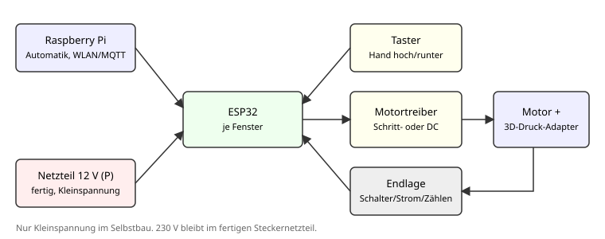

# Idee: Vorhandene Jalousien elektrisch nachrüsten

Stand: 22.10.2026, Vorschlag von Kevin (22.09.). Noch nicht entschieden, eine von mehreren Ideen.

## Idee

Die vorhandenen Jalousien oder Rollläden in der Mietwohnung (Karlsruhe) bekommen einen Motor
und eine Steuerung. Sie fahren dann per Taster, Handy oder automatisch nach Zeit, Sonne und Wecker.
Rahmen: Hobbyprojekt, 3 Leute, Budget Team 300 €, Raspberry Pi vorhanden.

Mietwohnung heißt: **nichts bohren oder umbauen, was sich nicht spurlos zurückbauen lässt**,
und **keine Eingriffe in die 230-V-Hausinstallation**.

## Welcher Typ? (entscheidet alles)

| Typ | Bedienung heute | Was bewegt werden muss | Lösungsweg |
|---|---|---|---|
| Rollladen (außen) | Gurt, Gurtwickler in der Wand | Gurt auf-/abwickeln, hohe Last | Fertiger Gurtwickler-Motor, ersetzt den Wickler |
| Raffstore / Außenjalousie | Kurbel mit Wendestab | Kurbelwelle drehen (viele Umdrehungen), Lamellen wenden | Selbstbau: Getriebe- oder Schrittmotor am Wendestab, Adapter 3D-Druck |
| Innenjalousie (Lamellen) | Kordel zum Hochziehen, Stab oder Kordel zum Wenden | Meist nur Wenden, Hochziehen ist schwer | Selbstbau: Schrittmotor am Wendestab, nur Lamellen wenden |
| Rollo / Plissee | Kugelkette | Kugelkette ziehen, wenig Last | Selbstbau: Motor mit gedrucktem Kettenrad |

### Rollladen mit Gurtwickler

Fertige Gurtwickler-Motoren gibt es im Baumarkt und online. Sie sitzen statt des alten
Wicklers in der Wand, oft mit eigener Zeitschaltung, manche mit Funk oder WLAN.
**Achtung:** Viele laufen direkt an 230 V und werden fest angeschlossen. Das machen wir nicht
selbst (siehe Sicherheit). In Frage kommen nur Modelle mit Stecker oder Batterie/Akku, oder der
Vermieter bzw. ein Elektriker schließt an. Vor dem Kauf prüfen, ob Gurtbreite und Einbautiefe
passen (Datenblatt des Modells, hier keine Werte angenommen). Wenig Bastelanteil.

### Raffstore / Jalousie mit Kurbel und Wendestab

Die Kurbel steckt meist mit einer Öse oder einem Mehrkant im Getriebe. Statt der Kurbel greift ein
Motor über einen gedruckten Adapter. Viele Umdrehungen bis zur Endlage, also Getriebemotor
(langsam, kräftig) oder Schrittmotor mit Untersetzung. Halterung am Fensterrahmen klemmen oder
kleben, nicht bohren. Drehmoment ist unbekannt und muss **gemessen** werden (Kurbel mit
Federwaage oder Drehmomentschlüssel).

### Innenjalousie mit Kordel oder Kugelkette

Wenden über den Wendestab ist leicht: kleiner Schrittmotor, gedruckte Kupplung. Kugelkette:
gedrucktes Kettenrad auf dem Motor, Gehäuse spannt die Kette. Hochziehen per Kordel ist
mechanisch unangenehm und wird zunächst ausgeklammert.

## Empfohlener Selbstbau-Pfad (Annahme, Team entscheidet)

Da nur Kleinspannung selbst gebaut wird und der Bastelanteil Spaß machen soll:

1. **Ein Fenster** mit Wendestab oder Kugelkette als Prototyp.
2. Motor (Schrittmotor mit Treiber oder 12-V-Getriebemotor mit H-Brücke) plus ESP32 je Fenster.
3. Adapter, Halter und Gehäuse aus dem 3D-Drucker.
4. Steuerung per MQTT vom Raspberry Pi, Automatik dort (z. B. Home Assistant oder Node-RED, offen).
5. Erst wenn das läuft: weitere Fenster.

Gibt es bei uns Rollläden mit Gurtwickler, ist ein fertiger Motor mit Stecker oder Akku der
einfachere Weg. Der ESP32-Teil kann dann trotzdem die Automatik übernehmen, falls der Motor
eine Schnittstelle hat (je Modell prüfen).

## Aufbau

## Stückliste je Fenster (Schätzpreise)

| Posten | ca. € (Schätzung) |
|---|---|
| ESP32-Board | 5 bis 10 |
| Schrittmotor mit Treiber oder Getriebemotor mit H-Brücke | 10 bis 30 |
| Steckernetzteil 12 V (P), fertig mit CE | 10 bis 15 |
| Endschalter, Taster, Kleinteile, Kabel | 5 bis 10 |
| Filament für Adapter, Halter, Gehäuse | 3 bis 5 |
| **Summe je Fenster** | **ca. 35 bis 70** |
| Alternativ: fertiger Gurtwickler-Motor (Stecker/Akku) | 40 bis 100 je Stück |

Raspberry Pi vorhanden. Mit 300 € sind etwa 4 bis 6 Fenster im Selbstbau drin (Schätzung),
inklusive Fehlkäufen eher 3 bis 4.

## Endlagenerkennung

Ohne Endlage wickelt der Motor zu weit und beschädigt die Jalousie. Möglichkeiten:

- **Endschalter** (Mikroschalter) oben und unten: einfach und sicher, braucht Montageplatz.
- **Schritte zählen** (Schrittmotor): nach einer Referenzfahrt gegen einen Schalter genau,
  verliert aber Schritte bei Überlast.
- **Strom messen** (Getriebemotor): Anstieg am Anschlag erkennen. Belastet Mechanik, nur als Zusatz.
- **Zeit**: Laufzeit begrenzen, immer als zweite Sicherung zusätzlich.

Vorschlag: Endschalter oder Referenzfahrt plus Laufzeitbegrenzung in der Firmware.

## Sicherheit: 230 V meiden

- Selbst gebaut wird **nur Kleinspannung** (z. B. 5 V oder 12 V).
- 230 V kommt nur aus einem **fertigen, zugelassenen Steckernetzteil**.
- Kein Anschluss an Unterputzdosen, keine fest angeschlossenen 230-V-Motoren selbst verdrahten.
  Das ist Sache eines Elektrikers und in der Mietwohnung mit dem Vermieter abzustimmen.
- Quetschgefahr: Motor stoppt bei Endschalter und Laufzeitgrenze, Handtaster hat Vorrang.

## Automatik

- **Zeit:** feste Zeiten, getrennt nach Werktag und Wochenende.
- **Sonne:** Sonnenauf- und -untergang für Karlsruhe berechnen (Bibliothek, kein Sensor nötig),
  optional Lichtsensor oder Wetterdaten für Hitzeschutz im Sommer.
- **Wecker:** Jalousie fährt langsam vor der Weckzeit hoch, z. B. Weckzeit vom Handy übernehmen (Weg offen).
- **Urlaub:** zufällige Zeiten zur Anwesenheitssimulation.
- Handtaster und manuelle Befehle gehen immer vor der Automatik.

## Meilensteine

| | Ziel |
|---|---|
| M1 | Typ und Anzahl der Fenster erfassen, Drehmoment an Kurbel/Stab/Kette messen |
| M2 | Ein Motor dreht über Adapter die Jalousie per Taster am ESP32 |
| M3 | Endlagenerkennung und Laufzeitgrenze, Dauertest an einem Fenster |
| M4 | Anbindung an den Raspberry Pi per MQTT, Steuerung vom Handy |
| M5 | Automatik (Zeit, Sonne, Wecker), weitere Fenster |

## Offene Entscheidungen

- **Welcher Typ ist bei uns vorhanden?** Rollladen mit Gurt, Raffstore mit Kurbel, Innenjalousie
  oder Kugelkette, und wie viele Fenster. (**offen, zuerst klären**)
- Ist ein fertiger Gurtwickler-Motor in Ordnung oder soll es Selbstbau sein? (offen)
- Schrittmotor oder Getriebemotor? Hängt vom gemessenen Drehmoment ab. (offen)
- Software auf dem Raspi: Home Assistant, Node-RED oder eigenes Skript? (offen)
- Was erlaubt der Vermieter (Klemmen, Kleben, Bohren)? (offen)
- Nur Lamellen wenden oder auch hoch und runter fahren? (offen)
