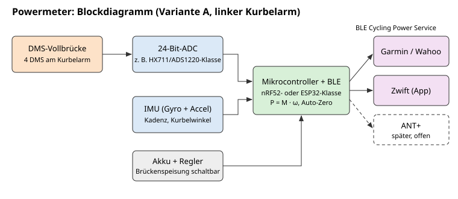
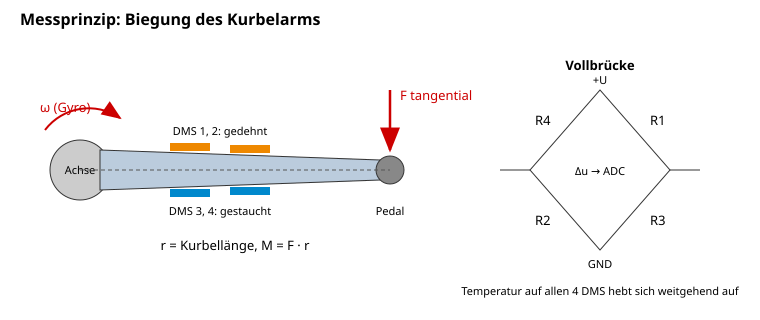

# Idee: Powermeter (Fahrrad-Leistungsmesser zum Selberbauen)

Stand: 22.10.2026. Noch nicht entschieden, eine von mehreren Ideen.
Rahmen: 3 Leute, Hobby, Budget Team 300 €, Karlsruhe.

## Idee

Ein selbst gebauter Leistungsmesser fürs Fahrrad: misst die Tretleistung in Watt und die
Trittfrequenz und sendet beides per Bluetooth an Radcomputer (Garmin, Wahoo) und
Trainings-Apps (Zwift). Kaufgeräte kosten ein Mehrfaches des Budgets; ein Eigenbau ist
machbar, weil das Messprinzip einfach ist. Schwer sind Genauigkeit, Temperaturverhalten,
Wasserschutz und vor allem: **am Kurbelarm hängt die Sicherheit des Fahrers**.

## Physik

**Leistung = Drehmoment mal Winkelgeschwindigkeit:** P = M · ω.

- M = F · r: Tangentialkraft am Pedal mal Kurbellänge (z. B. 0,1725 m).
- ω = 2π · Kadenz / 60 (Kadenz in U/min).
- Beispiel (Rechnung, keine Messung): 90 U/min → ω ≈ 9,42 rad/s. Bei 200 W ist das
  mittlere Drehmoment M = 200 / 9,42 ≈ 21 Nm, entsprechend ≈ 123 N mittlere
  Tangentialkraft am Pedal. Spitzen innerhalb der Umdrehung liegen deutlich höher.
- Gemittelt wird über eine Umdrehung (oder feste Zeitfenster): Leistung schwankt innerhalb
  der Kurbelumdrehung stark, angezeigt wird der Mittelwert.

### Dehnungsmessstreifen (DMS) in Vollbrücke

- Die Kraft am Pedal biegt den Kurbelarm minimal. DMS auf der Oberfläche ändern dabei
  ihren Widerstand im Promille-Bereich. Das Signal ist winzig (Mikrovolt bis wenige
  Millivolt je Volt Speisespannung, abhängig von Geometrie und Dehnung; nicht geschätzt).
- **Vollbrücke (4 DMS):** zwei auf der gedehnten, zwei auf der gestauchten Seite.
  Vorteile: maximale Empfindlichkeit, Temperatureinflüsse auf die DMS selbst heben sich
  weitgehend auf, Biegung in die falsche Richtung und Zug/Druck lassen sich je nach
  Anordnung ausblenden.
- Gemessen werden soll die **Biegung durch die Tangentialkraft**, nicht die radiale
  Kraft (Pedal drückt längs zum Arm) und nicht die Torsion des Arms. Die Position und
  Ausrichtung der DMS bestimmt, wie gut das gelingt. Das ist der eigentliche Kern des
  Projekts und muss experimentell geprüft werden.

### Temperaturdrift

- Aluminium und Stahl dehnen sich mit Temperatur, Kleber und DMS haben eigene
  Koeffizienten. Folge: der **Nullpunkt wandert** (z. B. Keller 15 °C, Sonne 35 °C).
- Gegenmittel: Vollbrücke, DMS passend zum Werkstoff (selbstkompensierende Typen gibt
  es für Stahl und Alu, Typ im Datenblatt prüfen), Temperatursensor nahe der Brücke,
  und **Auto-Zero**: wenn die Kurbel längere Zeit still steht oder rückwärts gedreht
  wird, wird der Nullpunkt neu gesetzt (so machen es auch kommerzielle Geräte).
- Die Steigung (Empfindlichkeit) driftet ebenfalls, aber meist weniger. Annahme, muss
  gemessen werden.

### Kadenz über IMU/Gyroskop

- Ein Gyroskop am Kurbelarm misst direkt die Winkelgeschwindigkeit ω, damit braucht man
  keinen Magneten am Rahmen.
- Der Beschleunigungssensor sieht die Schwerkraft rotieren (Sinus pro Umdrehung) und
  liefert den Kurbelwinkel, nützlich für Umdrehungszählung und "Kraft über Winkel".
- Die Zentrifugalkraft verfälscht den Beschleunigungssensor je nach Einbauradius;
  deshalb Kadenz primär aus dem Gyro, Winkel aus Fusion beider Sensoren.
- Bewährt wird oft: Leistung pro Umdrehung = mittleres Drehmoment · mittleres ω der
  Umdrehung; oder kontinuierlich P(t) = M(t) · ω(t), gemittelt.

## Varianten

| | A: Kurbelarm links (einseitig) | B: Spider (Kettenblattträger) | C: Pedal | D: Nabe (Hinterrad) |
|---|---|---|---|---|
| Messort | linker Kurbelarm, DMS auf der Innenseite | zwischen Kurbel und Kettenblättern | Pedalachse | Hinterradnabe |
| Erfasst | nur linkes Bein, Wert ×2 | beide Beine, Gesamtleistung | je Pedal, ggf. beide | Gesamt, nach Kettenverlusten |
| Mechanik | einfach, Arm bleibt Serienteil | Spider ist komplex geformt, mehrere Brücken nötig | Achse sehr klein, kaum Platz | Nabe einspeichen, Gehäuse dicht |
| Elektronik-Platz | Gehäuse am Arm, gut | ok | sehr eng | ok |
| Fehlerquelle | Links-rechts-Asymmetrie (oft einige Prozent, Schätzung) | Messung über mehrere Arme gemittelt | Kalibrierung zweier Seiten | Laufradbindung |
| Aufwand | gering bis mittel | hoch | sehr hoch | hoch |
| Risiko Mechanik | mittel (Kurbel bleibt unbearbeitet, nur geklebt) | mittel bis hoch | hoch | mittel (Speichen, Lager) |
| Budget 300 € | ja | knapp | eher nein | knapp |

## Empfehlung

**Variante A: linker Kurbelarm, einseitig.** Das ist der Weg, den auch viele
Kaufgeräte im Einstiegssegment gehen. Begründung:

- Linke Kurbel trägt kein Kettenblatt, gebraucht günstig zu bekommen, leicht zu tauschen.
- Eine Vollbrücke an einer gut zugänglichen, glatten Fläche.
- Elektronik passt in ein kleines Gehäuse an der Innenseite.
- Schwäche ehrlich: Gesamtleistung = 2 × links. Wer deutlich asymmetrisch tritt, sieht
  einen systematischen Fehler. Für Training und Vergleich mit sich selbst reicht das.

Eine Zwei-Seiten-Version (rechter Arm zusätzlich) ist später möglich, aber nicht Teil
des Starts. Annahme, Entscheidung beim Team.

## Elektronik (Prinzip)

Siehe Blockdiagramm. Konkrete Bauteile erst nach Datenblattprüfung festlegen;
die folgenden Namen sind **nur Beispiele für eine Klasse**, Daten bitte im Datenblatt nachlesen.

- **Brücke → ADC:** 24-Bit-Delta-Sigma-ADC mit Verstärker für Brückensignale.
  Beispiele: HX711 (Wägezellen-Standard, einfach, verbreitet) oder ADS1220-Klasse
  (flexibler, SPI, programmierbare Verstärkung und Datenrate). Wichtig zu prüfen:
  Abtastrate (für Kraft über Winkel braucht man deutlich mehr als einige Messungen pro
  Sekunde), Rauschen, Stromaufnahme, ratiometrische Messung.
- **IMU:** 6-Achsen (Beschleunigung + Gyro), I²C/SPI, mit Low-Power-Modus und
  Bewegungs-Interrupt zum Aufwecken.
- **Mikrocontroller mit BLE:** nRF52-Klasse (sehr sparsam, BLE ist Kernkompetenz,
  ANT-fähige Varianten existieren) oder ESP32-Klasse (vertrauter, WLAN für Updates,
  aber deutlich höherer Stromverbrauch, Laufzeit kritisch). Tendenz nRF52, offen.
- **Versorgung:** Knopfzelle (z. B. CR2032) oder kleiner LiPo mit Laderegler und
  Schutzschaltung. Brückenspeisung nur während der Messung einschalten.
- **Temperatursensor** nahe der DMS (oft im ADC oder in der IMU schon vorhanden; prüfen).
- **Schlafmodus:** IMU weckt bei Bewegung, sonst Tiefschlaf. Ziel Laufzeit: mehrere
  Wochen bis Monate pro Ladung/Batterie (Ziel, nicht berechnet).

## Protokolle und Kompatibilität

### BLE Cycling Power Service (CPS)

- Offener Bluetooth-SIG-Standard, Service-UUID 0x1818, Messwert-Characteristic
  "Cycling Power Measurement" (0x2A63) per Notify.
- Enthält momentane Leistung (Pflicht) und optional kumulierte Kurbelumdrehungen mit
  Zeitstempel, aus denen der Empfänger die Kadenz berechnet. Optional:
  "Pedal Power Balance" und eine Control-Point-Characteristic für Kalibrierbefehle
  (Offset Compensation). Genaue Flags und Formate aus der Spezifikation übernehmen,
  nicht raten.
- **Kompatibilität:** Garmin-Edge, Wahoo-ELEMNT und Zwift (über Smartphone, Tablet, PC
  mit Bluetooth) unterstützen Bluetooth-Leistungsmesser nach unserem Kenntnisstand;
  je Gerätemodell vor dem Bau prüfen (ältere Garmin-Geräte und Uhren können nur ANT+).
- Viele Apps verbinden sich nur mit **einem** Empfänger gleichzeitig per BLE; manche
  Kaufgeräte erlauben mehrere Verbindungen. Ob unser Stack das kann: offen.

### ANT+

- ANT+ hat ein eigenes Geräteprofil "Bicycle Power", sehr verbreitet bei Garmin.
- **Hürde ehrlich:** braucht einen Funkchip bzw. Softdevice mit ANT-Unterstützung
  (bei nRF52 gibt es das, aber mit eigenem Lizenzmodell), und die Nutzung von ANT+
  in einem Produkt ist an Lizenz-/Mitgliedsbedingungen von Garmin/ANT gebunden. Für
  ein privates Hobbygerät mag das anders aussehen, die Bedingungen sind aber **nicht
  geprüft**. Annahme: Start nur mit BLE, ANT+ später als Option.

## Kalibrierung

1. **Nullabgleich (Offset):** Kurbel waagerecht oder senkrecht unbelastet, Mittelwert
   der Brücke = Nullpunkt. Später automatisch im Stillstand (Auto-Zero), zusätzlich
   per App-Knopf (CPS Control Point).
2. **Steigung (Empfindlichkeit):** Kurbel **waagerecht**, Rad blockiert, bekanntes
   Gewicht am Pedal anhängen (z. B. 5 kg, 10 kg, 20 kg Hantelscheiben, Gewicht vorher
   auf einer Waage gewogen). Drehmoment = m · g · Kurbellänge. Mehrere Stufen,
   Ausgleichsgerade, Linearität prüfen.
3. **Kontrolle:** Gewicht an anderer Stelle am Pedal (innen/außen) aufhängen, um den
   Einfluss des Kraftangriffspunkts zu sehen. Anschließend Vergleich mit einem
   geliehenen Kaufgerät oder Smart-Trainer.
4. **Temperatur:** Nullpunkt bei Kühlschrank-, Raum- und Sonnentemperatur notieren,
   daraus Kompensation ableiten.

**Genauigkeitsziel (Schätzung):** ± 3-5 % auf die gemittelte Leistung bei konstanter
Temperatur nach Kalibrierung, plus Fehler durch Links-rechts-Asymmetrie. Kaufgeräte
werben meist mit etwa ±1-2 %; das zu erreichen ist für den ersten Prototypen
nicht realistisch (Schätzung).

## Mechanik

- **Kurbelarm:** Gebrauchte Alu-Kurbel links, passend zum Tretlager des Testrads.
  **Nicht bohren, nicht fräsen, keine Kerben.** Nur Lack lokal sehr vorsichtig entfernen
  (feines Schleifpapier), Oberfläche entfetten.
- **DMS kleben:** nach Herstelleranleitung mit dem dafür vorgesehenen Klebstoff
  (Cyanacrylat- oder Epoxid-DMS-Kleber), Andruck, Aushärten. Ausrichtung mit Anreißlinien.
  Übung auf einem Alu-Reststück vorher.
- **Verkabelung:** dünne Lackdraht-/Litzenverbindungen zu Lötstützpunkten, Zugentlastung.
- **Schutz:** DMS mit Abdeckmasse (Silikon, Wachs oder spezielle Abdeckung für DMS),
  danach Gehäuse.
- **Gehäuse und Wasserschutz:** 3D-gedrucktes Gehäuse an der Innenseite des Arms,
  Abstand zur Kettenstrebe prüfen (wenige Millimeter Spielraum, je nach Rahmen).
  Dichtung mit O-Ring oder Verguss der Elektronik. Regen und Hochdruckreiniger sind die
  Prüfung. Verguss macht Reparatur unmöglich, daher erst Prototyp ungegossen.
- **Akku:** Knopfzelle mit Schraubdeckel (einfach, tauschbar) oder LiPo mit Ladekontakten
  (magnetisch oder Pogo-Pins) bzw. kabellos. Wechsel ohne Öffnen der Elektronik.
- **Befestigung:** Gehäuse kleben oder mit Kabelbinder/Klemmband; nie Bohrungen.

## Bekannte Projekte und Quellen

Es gibt mehrere Open-Source-/Bastler-Powermeter im Netz (Kurbel-DMS mit HX711 und
nRF52 oder ESP32). Wir nennen hier bewusst **keine Namen**, solange niemand Link und
Lizenz geprüft hat. Aufgabe für M1: Recherche, Links mit Lizenz hier eintragen.

Grundlagen zum Nachlesen: Bluetooth-SIG-Spezifikation "Cycling Power Service" und
"Cycling Power Profile", Datenblätter des gewählten ADC, DMS-Herstelleranleitungen.

## Stückliste (Schätzpreise)

| Teil | Menge | Preis (Schätzung) |
|---|---|---|
| Gebrauchte linke Kurbel (Alu), passend | 1-2 (eine als Übungsteil) | 20-50 € |
| Dehnungsmessstreifen, passend zu Alu | Set (für 2-3 Versuche) | 20-50 € |
| DMS-Kleber, Abdeckmasse, Schleifpapier, Entfetter | 1 Set | 15-30 € |
| ADC-Modul (HX711- oder ADS1220-Klasse) | 2 | 5-20 € |
| BLE-Board nRF52-Klasse (Dev-Board) | 2 | 20-40 € |
| IMU-Modul 6-Achsen | 2 | 5-15 € |
| Akku/Knopfzellenhalter, Laderegler | 2 | 5-15 € |
| Gehäuse (3D-Druck), O-Ringe, Verguss | 1 Set | 10-25 € |
| Eigene Platine (später, kleiner) | 1 Bestellung | 15-30 € (P) |
| Kalibriergewichte (Hantelscheiben, ggf. vorhanden) | 10-20 kg | 0-30 € |
| Kleinteile, Kabel, Lötzubehör | | 10-20 € |
| **Summe** | | **ca. 125-325 €** (Schätzung) |

Kaufgerät zum Vergleichen: ausleihen (Verein, Freunde, Radladen in Karlsruhe) statt kaufen.
Wer einen Smart-Trainer hat, kann ihn als Referenz nutzen.

## Meilensteine

1. **M1 Recherche und Labor:** Open-Source-Projekte prüfen, DMS auf Alu-Reststück
   kleben, Brücke an ADC, Signal sehen. Bauteilwahl nach Datenblatt.
2. **M2 Kurbel statisch:** DMS auf Übungskurbel, Gewichte-Kalibrierung im Montageständer,
   Linearität und Temperaturdrift messen.
3. **M3 Kadenz und Leistung:** IMU auf Kurbel, P = M · ω im Ständer/auf der Rolle, Daten
   per Seriell/Logging. Vergleich mit Referenz.
4. **M4 BLE CPS:** Cycling Power Service, Verbindung mit Zwift und einem Radcomputer,
   Auto-Zero, Kalibrierbefehl.
5. **M5 Straße:** Gehäuse, Wasserschutz, Akkulaufzeit, Testfahrten (zuerst ruhig,
   Prüfung der Kurbel vor und nach jeder Fahrt), eventuell eigene Platine.

## Risiken

- **Kurbelbruch (Sicherheit!):** Ein brechender Kurbelarm bei Wiegetritt führt zu
  schweren Stürzen. Regeln: **keine spanende Bearbeitung am Arm, keine Kerben, kein
  Erhitzen**, nur kleben. Nur unbeschädigte Kurbeln (kein Sturzteil). Gehäuse darf
  nirgends anschlagen. Regelmäßige Sichtprüfung auf Risse. Im Zweifel Kurbel tauschen.
- **Gehäuse kollidiert** mit Kettenstrebe oder Schuh: vor der Fahrt langsam durchdrehen.
- **Genauigkeit unter dem Ziel:** DMS-Position ungünstig, Drift zu groß. Gegenmittel:
  Übungsteil, mehrere Positionen testen.
- **Wasser/Korrosion** an DMS und Elektronik: Signal wandert oder fällt aus.
- **Akkulaufzeit** zu kurz, vor allem mit ESP32-Klasse.
- **Kompatibilität:** Gerät X findet den Sensor nicht oder nur per ANT+.
- **Lithium-Akku** am drehenden Teil: Schutzschaltung, kein beschädigter Akku.
- **Zeitaufwand** durch Iterationen beim Kleben (jeder Fehlversuch kostet DMS und Zeit).

## Offene Entscheidungen

- Variante A bestätigen? Später zweiseitig? (Annahme: A, einseitig)
- Mikrocontroller-Klasse: nRF52 oder ESP32 (Annahme: nRF52 wegen Stromverbrauch)
- ADC: HX711 oder ADS1220-Klasse (nach Datenblattvergleich, Abtastrate entscheidend)
- Nur BLE oder auch ANT+ (Annahme: erst BLE; ANT+-Bedingungen nicht geprüft)
- Akku: Knopfzelle oder LiPo mit Ladekontakten
- Welche Kurbel/welches Testrad (Tretlagerstandard, Kurbellänge)
- Referenz zum Vergleich: wessen Smart-Trainer oder Leihgerät
- Wer fährt Testfahrten, unter welchen Sicherheitsregeln
