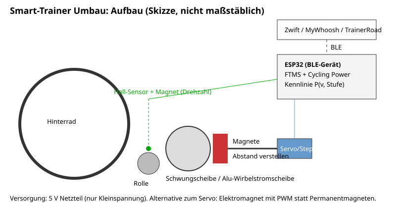
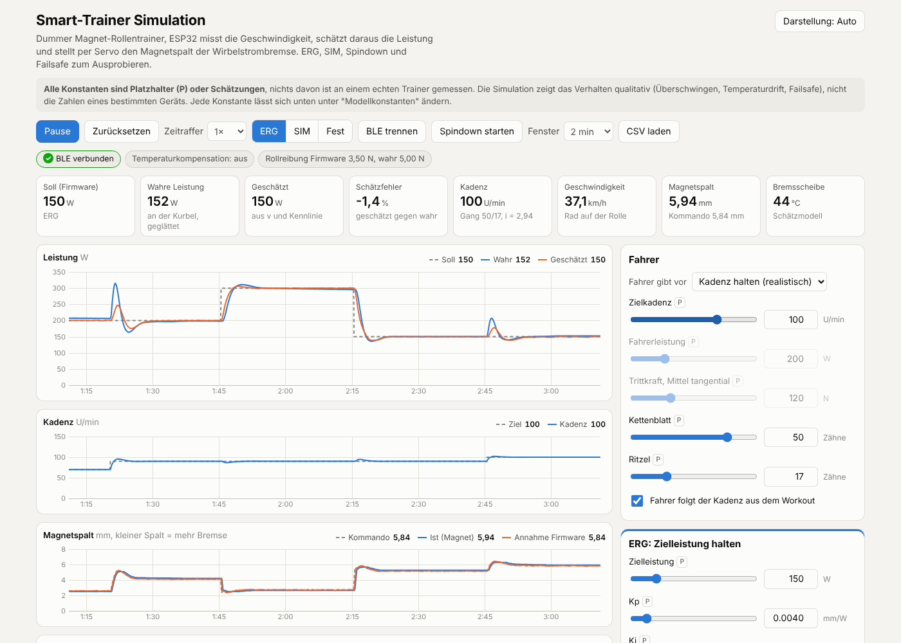
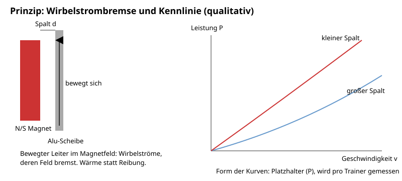

# Idee: Dummen Rollentrainer zum Smart-Trainer umbauen

Stand: 22.10.2026, **Vorschlag von Claude** (nicht aus dem Team). Noch nicht entschieden, eine von mehreren Ideen.

## Idee

Im Karlsruher Winter (dunkel, nass, Rheinebene im Nebel) wird drinnen gefahren. Ein Smart-Trainer
mit Zwift, MyWhoosh oder TrainerRoad kostet neu mehrere hundert Euro. Gebrauchte "dumme" Rollentrainer
mit Magnetbremse gibt es auf Kleinanzeigen dagegen für wenig Geld. Die Idee: so einen Trainer kaufen,
einen ESP32 dranbauen, der die Geschwindigkeit misst, daraus die Leistung schätzt, den Widerstand
selbst verstellt und sich per Bluetooth (BLE) als normaler Smart-Trainer meldet. Die Apps merken
keinen Unterschied.

**Zum Ausprobieren:** [`sim/index.html`](sim/index.html) ist eine interaktive Simulation im Browser
(eine Datei, ohne Installation). Fahrer mit Kadenz, Gang und Schwungmasse, Wirbelstrombremse mit
Kennlinienfamilie über den Magnetspalt, Servo mit Totzeit und begrenzter Stellgeschwindigkeit,
ERG mit PI-Regler und Anti-Windup, SIM mit Straßenmodell, Spindown, Failsafe bei BLE-Abbruch,
Leistungsschätzung gegen wahre Leistung und ein einfaches Temperaturmodell der Bremsscheibe.
Alle Konstanten sind Platzhalter (P) bzw. Schätzungen und in der Seite änderbar.

## Prinzip Wirbelstrombremse

Die meisten günstigen Trainer bremsen mit Permanentmagneten neben einer Aluminium- oder Kupferscheibe
(oft die Schwungscheibe selbst). Dreht sich die Scheibe, entstehen in ihr Wirbelströme, deren Magnetfeld
der Bewegung entgegenwirkt. Die Bremsleistung steigt mit der Geschwindigkeit und mit der Feldstärke
im Leiter; die Feldstärke hängt stark vom Spalt zwischen Magnet und Scheibe ab. Die Energie wird zu Wärme
in der Scheibe. Typisch haben solche Trainer einen Bowdenzug-Hebel am Lenker mit mehreren Stufen, der
nichts anderes tut als die Magnetplatte näher an die Scheibe zu schieben.

Daraus folgt: Wer den Spalt elektrisch verstellen kann und die Kennlinie P(v, Spalt) kennt, hat einen
Smart-Trainer.

## Widerstand verstellen

| Weg | Wie | Für | Gegen |
|---|---|---|---|
| A: Servo am Bowdenzug/Magnetarm | Modellbau-Servo ersetzt den Lenkerhebel, zieht den Zug | Am einfachsten, Mechanik bleibt original | Spiel im Zug, Servo-Auflösung, Kraft am Zug unbekannt (messen) |
| B: Schrittmotor mit Spindel am Magnetarm | Stepper plus Gewindestange, Endschalter für Nullpunkt | Wiederholgenau, feine Stufen | Mehr Mechanik, Halterung muss je Trainer angepasst werden |
| C: Elektromagnet-Bremse mit PWM | Permanentmagnete durch Spule(n) ersetzen, Feld per PWM/MOSFET | Keine bewegten Teile, schnell regelbar | Spule selbst wickeln oder finden, Strom und Wärme, deutlich mehr Entwicklung |

Annahme (offen): Für den ersten Prototyp wäre A naheliegend. Entscheidung beim Team.

## Leistung bestimmen

**Schätzung über Kennlinie (Standardweg):** Hall-Sensor oder Reed-Kontakt mit Magnet an der Rolle
oder Schwungscheibe liefert die Drehzahl. Für jede Widerstandsstellung wird einmal eine Kurve
P(v) aufgenommen; der ESP32 interpoliert zwischen Stützpunkten. Kalibriert wird gegen einen
Referenz-Powermeter (eigener oder geliehener), indem man pro Stufe mehrere konstante Geschwindigkeiten fährt.

- Genauigkeit hängt ab von: Reifendruck und Anpressdruck der Rolle, Temperatur der Scheibe (Widerstand
  des Leiters steigt warm), Spiel in der Verstellung. Wie groß die Abweichung wird: unbekannt, erst messen (P).
- Spindown-Test vor jeder Fahrt (wie bei kommerziellen Trainern) kann Anpressdruck-Schwankungen ausgleichen.

**Direkte Messung (Ausbau):** Dehnungsmessstreifen an einer Drehmomentstütze der Bremse oder Kurbel-/Pedal-Powermeter
am Rad, dessen Werte der ESP32 nur durchreicht. Genauer, aber teurer bzw. mechanisch aufwendiger.

## Bluetooth: was die Apps erwarten

Der ESP32 tritt als BLE-Peripheral auf. Verwendet werden die offenen Bluetooth-SIG-Profile:

- **Fitness Machine Service (FTMS)**: meldet "Indoor Bike Data" (Geschwindigkeit, Trittfrequenz, Leistung)
  und nimmt über den "Control Point" Befehle an:
  - **ERG-Modus** (Zielleistung setzen): Der ESP32 regelt den Widerstand so, dass bei aktueller
    Geschwindigkeit die Zielleistung herauskommt. Mit Kennlinie heißt das: passende Stufe nachschlagen,
    nachführen, Regelung ruhig genug, dass es nicht pumpt.
  - **Steigungssimulation** (Indoor Bike Simulation Parameters: Steigung, Wind, Rollwiderstand):
    Daraus mit einem einfachen Fahrphysik-Modell eine Sollleistung zur aktuellen Geschwindigkeit
    rechnen, dann wie im ERG-Modus verstellen.
- **Cycling Power Service (CPS)**: zusätzlich, damit auch Apps/Geräte ohne FTMS die Leistung sehen.
- Optional Cycling Speed and Cadence. Trittfrequenz braucht einen eigenen Sensor an der Kurbel oder
  wird von einem vorhandenen Sensor direkt an die App geliefert.

Welche App welche Teile von FTMS tatsächlich nutzt, ist im Test zu prüfen (offen). Feldformate und
UUIDs werden aus den offiziellen Spezifikationen der Bluetooth SIG übernommen, nicht hier ausgedacht.
Für den ESP32 gibt es Bibliotheken (z. B. NimBLE-Arduino) und Open-Source-Projekte mit FTMS, die man
als Vorlage anschauen kann.

## Varianten

| Variante | Umfang | Kosten (Schätzung) | Aufwand |
|---|---|---|---|
| 1: Nur Leistung | Drehzahl + Kennlinie, feste Stufe per Hand, BLE CPS/FTMS ohne Steuerung | ca. 40 bis 70 € | gering |
| 2: Smart mit Servo | wie 1, plus Servo am Zug, ERG und Steigung | ca. 60 bis 110 € | mittel |
| 3: Smart mit Stepper | wie 2, Stepper + Spindel + Endschalter | ca. 70 bis 130 € | mittel bis hoch |
| 4: Elektromagnet | Spulenbremse mit PWM statt Permanentmagnet | ca. 80 bis 150 € | hoch |
| + direkte Messung | DMS an der Bremse oder Powermeter durchreichen | +20 bis 300 € | je nach Weg |

Alle Preise inklusive gebrauchtem Trainer, ohne Fahrrad und Tablet.

## Sicherheit

- **Schwungmasse:** drehende Scheibe und Rolle. Finger, Kabel, Kleidung fernhalten; neue Anbauteile
  abdecken, Kabel fixieren. Kein Gehäuseteil darf in die Scheibe geraten.
- **Wärme der Bremse:** die komplette Tretleistung wird in der Scheibe zu Wärme. Elektronik und
  3D-Druckteile (PLA wird früh weich) nicht direkt an die Scheibe; Temperatur im Test messen.
  Bei Variante 4 zusätzlich Spulenwärme.
- **Nur Kleinspannung:** fertiges, geprüftes Steckernetzteil (5 V oder 12 V), keine Arbeiten an 230 V.
- **Regelung mit Begrenzung:** Firmware begrenzt die maximale Verstellung und fährt bei Verbindungsabbruch
  oder Fehler auf niedrigen Widerstand. Ein plötzlicher Maximalwiderstand im Sprint ist unangenehm.
- Trainer steht stabil, Schnellspanner korrekt, Rahmen geeignet (Carbon-Hersteller-Freigabe beachten).

## Stückliste (Schätzpreise)

| Posten | ca. € |
|---|---|
| Gebrauchter dummer Magnet-Trainer (Kleinanzeigen) | 20 bis 60 |
| ESP32-Board | 5 bis 10 |
| Hall-Sensor oder Reed-Kontakt + Magnet | 2 bis 5 |
| Servo (Variante 2) oder Stepper + Treiber + Spindel + Endschalter (Variante 3) | 10 bis 40 |
| Netzteil (Kleinspannung), Kabel, Stecker | 10 bis 15 |
| Halterungen aus dem 3D-Drucker, Schrauben | 5 |
| Trittfrequenzsensor (falls keiner vorhanden) | 15 bis 25 |
| Referenz-Powermeter | leihen, oder aus [`powermeter`](../powermeter/) |

Summe Variante 2: grob 60 bis 110 € (Schätzung), passt ins Budget von 300 €.

## Meilensteine

1. **M1 Trainer und Drehzahl:** Trainer kaufen, Hall-Sensor anbringen, Geschwindigkeit seriell ausgeben.
2. **M2 BLE als Powermeter:** ESP32 meldet CPS und FTMS Indoor Bike Data mit Platzhalter-Kennlinie (P); App erkennt das Gerät.
3. **M3 Kalibrierung:** Kennlinie je Stufe gegen Referenz-Powermeter aufnehmen, Abweichung dokumentieren.
4. **M4 Verstellung:** Servo oder Stepper anbauen, Stellungen reproduzierbar anfahren, Kennlinie pro Stellung.
5. **M5 ERG und Steigung:** FTMS Control Point, Regelung, Test in Zwift, MyWhoosh, TrainerRoad.
6. **M6 (optional):** Spindown-Kalibrierung, Temperaturkompensation, direkte Messung.

## Synergien

- [`ideen/powermeter`](../powermeter/): ein selbstgebauter Powermeter wäre die Referenz für die Kalibrierung,
  umgekehrt ist der Trainer ein Prüfstand für den Powermeter.
- [`ideen/gravel-navi`](../gravel-navi/): gleicher BLE-Stack auf dem ESP32 (Cycling Power, Speed/Cadence),
  Code und Erfahrung teilbar.

## Offene Punkte

- Welcher Trainer (Modell und Bremsart bestimmt den Umbau), welche Verstellvariante.
- Erreichbare Genauigkeit der Kennlinie, Temperaturdrift: nur durch Messung.
- Woher die Referenz kommt (leihen, eigener Powermeter).
- Welche Apps welche FTMS-Funktionen nutzen.
- Maximale Bremsleistung des gebrauchten Trainers: reicht sie für Sprints und steile Rampen?
