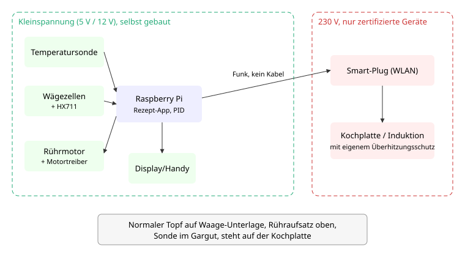

# Idee: Topf-Addon (Thermomix zum Selberbauen)

Stand: 22.10.2026, Vorschlag von Andy (20.09.). Noch nicht entschieden, eine von mehreren Ideen.

## Idee

Entweder ein Nachbau eines Thermomix oder ein Aufsatz, der aus einem normalen Topf einen
"Thermomix" macht: **Heizung, Rührwerk, Waage**, gesteuert von einer Rezept-App mit
Schrittmodus. Rahmen: 3 Leute, Hobby, Budget Team 300 €, Raspberry Pi vorhanden, Karlsruhe.

## Varianten

| | A: Vollnachbau | B: Rühraufsatz + Heizungssteuerung | C: Rührwerk, Sonde, Waage, App |
|---|---|---|---|
| Was | Eigener Mixtopf mit Heizelement, Messer, Motor, Waage im Gehäuse | Rühraufsatz auf normalem Topf; Hitze von vorhandener Induktionsplatte (falls ansteuerbar) oder Kochplatte über Smart-Plug/Thermostat | Rühraufsatz, Temperatursonde, Waage-Unterlage; Hitze stellt der Mensch nach Ansage der App ein |
| Heizung | selbst gebaut, 230 V | zertifiziertes Gerät, nur ein/aus bzw. Stufe | zertifiziertes Gerät, von Hand |
| Temperaturregelung | voll | grob (ein/aus) bis mittel | keine, nur Anzeige und Alarm |
| Risiko | hoch (230 V, Lebensmittel, hohe Drehzahl) | mittel | gering |
| Aufwand | sehr hoch | mittel | gering bis mittel |
| Budget 300 € | eher nicht | ja | ja |

## Ehrliche Bewertung

- **230-V-Heizung selbst bauen** ist für ein Hobbyprojekt ohne Elektrofachkraft nicht
  vertretbar: Berührschutz, Erdung, Isolation bei Feuchtigkeit und Dampf, Übertemperatur.
  Regel für diese Idee: **Nur Kleinspannung selbst bauen. Heizung kommt aus einem
  zertifizierten Gerät** (Kochplatte mit eigenem Überhitzungsschutz), geschaltet höchstens
  über einen fertigen, zugelassenen Smart-Plug. Kein Eingriff in die Geräte.
- **Lebensmittelkontakt:** Alles, was ins Essen ragt (Rührflügel, Welle, Sonde), aus
  lebensmittelechtem Material, z. B. Edelstahl. 3D-Druck im Topf ist problematisch
  (Rillen, Hitze, Materialfreigabe). Teile müssen spülbar sein. Fertige Teile kaufen.
- **Smart-Plug + Kochplatte:** Viele Platten starten nach Stromunterbrechung nicht von
  selbst oder vertragen häufiges Schalten schlecht. Vorher prüfen, Ergebnis als Annahme
  markieren. Induktionsplatten mit Fernsteuerung: Schnittstelle unbekannt, nicht annehmen.
- **Mixen/Zerkleinern** wie beim Thermomix (hohe Drehzahl, Messer) ist ein eigenes
  Risiko und nicht im Budget. Ziel ist **Rühren**, nicht Mixen.
- **Unbeaufsichtigt kochen:** nicht vorgesehen. Die App ersetzt nicht den Menschen am Herd.

## Empfehlung

**Variante C als Start, ausbaubar zu B.** C liefert den Kern (Rezept-Schrittmodus, Waage,
Rühren, Temperatur im Blick) mit Kleinspannung. Wenn das läuft, kommt die Heizung über
Smart-Plug dazu (B), sofern eine passende Kochplatte das zulässt. A wird nicht empfohlen.
Das Team entscheidet.

## Aufbau

Links alles Selbstgebaute in Kleinspannung, rechts nur fertige 230-V-Geräte, verbunden
nur per Funk (WLAN zum Smart-Plug).

## Temperaturregelung (Konzept, erst Variante B)

- Messgröße: Temperatursonde im Gargut (lebensmitteltaugliche Hülse). Sensortyp offen.
- Stellgröße: Smart-Plug ein/aus. Weil nur ein/aus geht, wird der PID-Ausgang als
  **Zeitproportional-Schaltung** umgesetzt: Ausgang 0 bis 100 % = Anteil "ein" in einem
  festen Zeitfenster (Fensterlänge (P), mit Rücksicht auf Schaltzyklen des Plugs).
- PID: P für Abweichung, I gegen bleibenden Fehler, D dämpft Überschwingen. Kochplatten
  sind träge (Restwärme), daher eher vorsichtiger P-Anteil und Anti-Windup für I.
- Parameter Kp, Ki, Kd: (P), durch Versuch mit Wasser bestimmen, nicht schätzen.
- Grenzen: Höchsttemperatur (P), Sonde nicht im Gargut / Messwert unplausibel ->
  Plug aus. Kein Messwert über Zeit (P) -> Plug aus. Plug ohne Rückmeldung -> Alarm.
- Variante C: dieselbe Messung, aber nur Anzeige und Hinweis "Stufe runter".

## Waage (HX711-Prinzip)

- Wägezellen (Dehnungsmessstreifen in Brückenschaltung) unter einer Platte, auf der
  der Topf steht. Der HX711 ist ein Wandler-Baustein, der das sehr kleine Brückensignal
  verstärkt und digitalisiert und seriell an den Pi gibt.
- Anzahl und Nennlast der Zellen: offen, müssen Topf + Inhalt + Kochplatte(?) tragen.
  Werte erst aus Datenblatt der gekauften Teile.
- **Tara** vor jedem Schritt (Topf und bisheriger Inhalt auf null), **Kalibrierung**
  mit bekanntem Gewicht, Faktor gespeichert.
- Stehen Waage und Kochplatte übereinander, wirken Hitze und Rührkräfte auf die Messung.
  Annahme (offen): Wiegen nur bei stehendem Rührwerk; Waage wärmegeschützt.
- Pinbelegung und Bibliothek erst nach Abgleich mit Pi-Pinout und Datenblatt.

## Rezept-Schrittmodus wie Thermomix

Ein Rezept ist eine Liste von Schritten, je Schritt z. B.:

| Feld | Beispiel |
|---|---|
| Text | "Zwiebeln zugeben" |
| Zielgewicht | 150 g, Fortschrittsbalken bis Ziel |
| Temperatur | Zielwert (B) oder Hinweis zur Stufe (C) |
| Rühren | Stufe, Dauer, Intervall |
| Zeit | Countdown |
| Weiter | per Knopf oder automatisch bei Zielgewicht/Zeit |

Rezepte als einfache Dateien (z. B. JSON/YAML), Oberfläche im Browser vom Pi aus (Handy
oder Tablet). Format offen.

## Stückliste (Schätzpreise, nicht recherchiert)

| Posten | ca. € |
|---|---|
| Getriebemotor Kleinspannung + Treiber | 20 bis 40 |
| Rührflügel/Welle Edelstahl, Halterung am Topfrand | 20 bis 50 |
| Temperatursonde lebensmitteltauglich + Wandler | 15 bis 30 |
| Wägezellen + HX711 + Platte | 15 bis 35 |
| Netzteil, Kabel, Gehäuse, Kleinteile | 20 bis 40 |
| Display/Taster (optional, sonst Handy) | 0 bis 30 |
| **Summe C** | **ca. 90 bis 225** |
| Smart-Plug zugelassen (B) | 10 bis 25 |
| Kochplatte, falls keine vorhanden (B) | 30 bis 60 |
| **Summe B** | **ca. 130 bis 310** |

Raspberry Pi vorhanden. B liegt am oberen Rand des Budgets.

## Meilensteine

1. **M1 Waage:** HX711 am Pi, Tara, Kalibrierung, Anzeige im Browser.
2. **M2 Rezept-App:** Schrittmodus mit Zielgewicht und Timer, ohne Hardware sonst.
3. **M3 Rührwerk:** Aufsatz am Topf, Stufen und Intervall aus dem Rezept.
4. **M4 Temperatur:** Sonde, Anzeige, Alarm (Ende Variante C).
5. **M5 Heizung (B):** Smart-Plug, Zeitproportional-PID, Sicherheitsabschaltungen, Test mit Wasser.

## Offene Entscheidungen

- Variante (A, B, C) und ob B überhaupt angegangen wird.
- Vorhandene Kochplatte/Induktion: welche, startet sie nach Stromunterbrechung wieder?
- Smart-Plug-Modell und Anbindung (lokal, ohne Cloud?).
- Temperatursensor-Typ und Bauform der Sonde.
- Rührer: Befestigung (Topfrand, Deckel, Bügel), Motor, Drehzahlbereich.
- Wägezellen: Anzahl, Nennlast, Position (unter Topf oder unter Platte).
- Bedienung: nur Handy oder eigenes Display.
- Rezeptformat und ob Rezepte geteilt werden.
