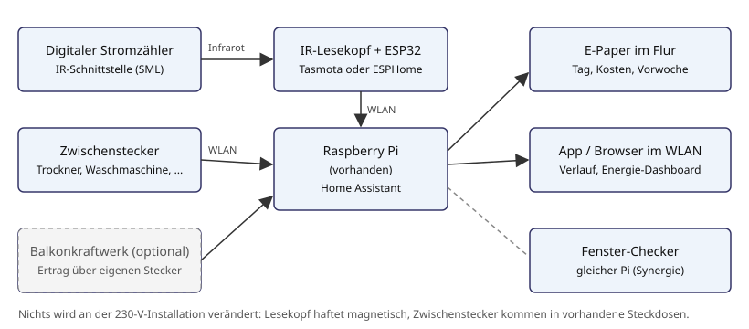
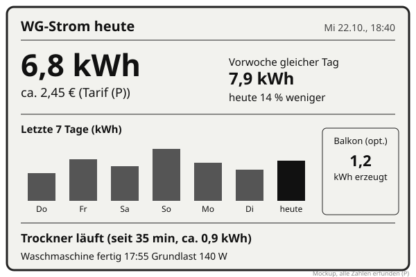

# Idee: WG-Energie-Dashboard

Stand: 22.10.2026, **Vorschlag von Claude** (nicht aus dem Team). Noch nicht entschieden, eine von mehreren Ideen.

## Idee

Eine Anzeige im Flur zeigt, wie viel Strom die WG heute verbraucht hat, was das ungefähr kostet,
wie der Tag im Vergleich zur Vorwoche dasteht und welches große Gerät gerade läuft
("Wer hat den Trockner laufen?"). Die Daten kommen aus zwei Quellen:

1. **Der digitale Stromzähler** im Zählerschrank. Moderne Zähler haben eine optische
   Infrarot-Schnittstelle, über die sie Zählerstände im SML-Protokoll aussenden. Ein IR-Lesekopf
   wird magnetisch davorgesetzt und an einen ESP32 angeschlossen.
2. **Zwischenstecker mit Leistungsmessung** an den Großverbrauchern (Trockner, Waschmaschine,
   eventuell Gefrierschrank oder Gaming-PC). Sie zeigen, welches Gerät welchen Anteil hat.

Home Assistant läuft auf dem vorhandenen Raspberry Pi, sammelt alles, rechnet Tageswerte und Kosten
und liefert sie an ein E-Paper-Display im Flur sowie an App und Browser.

Rahmen: 3 Leute, Hobbyprojekt, Mietwohnung, Budget Team 300 €.

**Mieter-tauglich:** Es wird nichts an der 230-V-Installation verändert. Der Lesekopf haftet nur
mit einem Magneten am Zähler, die Zwischenstecker kommen in vorhandene Steckdosen. Kein Eingriff in
Zählerschrank, Verteilung oder Unterputzdosen. Alles ist ohne Spuren wieder abbaubar.

## Aufbau

So könnte die Anzeige im Flur aussehen (Mockup, Zahlen erfunden):

## Der Zähler: was man ehrlich erwarten kann

Hier liegt die größte Unbekannte der Idee. Vor jedem Kauf muss jemand in den Zählerschrank schauen.

- **Zählertyp klären.** In Deutschland hängen in Mietwohnungen meist entweder alte
  Ferraris-Zähler (Drehscheibe), "moderne Messeinrichtungen" (mME, digitaler Zähler ohne
  Kommunikationsmodul) oder "intelligente Messsysteme" (iMSys, mit Smart-Meter-Gateway).
  Nur bei digitalen Zählern mit optischer Schnittstelle funktioniert der Lesekopf.
- **PIN für volle Daten.** Viele mME senden ohne Freischaltung nur den Zählerstand in
  ganzen kWh oder gar keine Momentanleistung. Für feinere Werte (Nachkommastellen,
  aktuelle Leistung in W) muss man oft eine **PIN beim Netzbetreiber anfordern** und am Zähler
  eingeben (bei vielen Modellen per Taschenlampe an der optischen Taste). Das ist in der Regel
  kostenlos und ohne Vermieter möglich, wer den Vertrag hat, fragt an. **Welche Daten unser
  Zähler wirklich liefert, ist offen (P)**, Hersteller und Modell stehen auf dem Typenschild.
- **Ohne PIN** reicht der Zählerstand immerhin für Tagesverbrauch und Kosten, nur "jetzt gerade
  2,1 kW" fehlt. Die Zwischenstecker liefern Momentanwerte trotzdem für die gemessenen Geräte.
- **Alter Ferraris-Zähler:** Lesekopf geht nicht. Ausweg wäre ein Sensor, der die rote Markierung
  der Drehscheibe zählt (Variante D), deutlich ungenauer.
- **iMSys mit Gateway:** Daten kommen eventuell auch über das Gateway (HAN-Schnittstelle).
  Das ist von Betreiber zu Betreiber unterschiedlich und wird hier nicht weiter vorausgesetzt.
- **Zugang zum Zählerschrank.** Steht der Zähler im Keller oder im Treppenhaus, braucht der
  ESP32 dort WLAN und Strom (USB-Netzteil an einer Steckdose in der Nähe). Liegt er außerhalb
  der Wohnung, kurz mit dem Vermieter bzw. der Hausverwaltung abstimmen, ob ein kleines
  Gerät am eigenen Zähler hängen darf. **(Offen)**

Konkrete Zählermodelle, OBIS-Kennzahlen und Lesekopf-Pinbelegungen werden erst eingetragen,
wenn wir unseren Zähler und den gekauften Lesekopf kennen. Hier wird nichts davon vorweggenommen.

## Lösungsvarianten

| | A: IR-Lesekopf + Zwischenstecker + HA | B: Nur Zwischenstecker | C: Fertiges Komplettsystem | D: Ferraris-Scheibe zählen |
|---|---|---|---|---|
| Prinzip | Lesekopf am Zähler mit ESP32 (Tasmota oder ESPHome), dazu Messstecker an Großverbrauchern, alles in Home Assistant | Nur Messstecker, kein Gesamtverbrauch | Lesekopf mit Hersteller-App oder Cloud-Dienst | Optischer Sensor zählt Umdrehungen der Drehscheibe |
| Gesamtverbrauch | ja | nein, nur gemessene Geräte | ja | ja, grob |
| "Wer hat den Trockner" | ja | ja | meist nein | nur mit Steckern |
| Kosten (Schätzung) | 90 bis 250 € | 50 bis 120 € | 80 bis 200 € | 70 bis 150 € |
| Aufwand | mittel | gering | gering | mittel bis hoch (Justage) |
| Bastelanteil | Firmware, HA-Konfiguration, Display, Gehäuse (3D-Druck) | HA-Konfiguration, Display | fast keiner | Sensor, Justage, Firmware |
| Risiko | Zähler liefert ohne PIN wenig, WLAN am Zählerort | Grundlast bleibt unsichtbar | Cloud, Daten beim Anbieter, wenig Lernwert | ungenau, Fehlzählungen |
| Voraussetzung | digitaler Zähler mit IR-Schnittstelle | keine | je nach Anbieter | Ferraris-Zähler |

**Annahme als Ausgangspunkt: Variante A**, weil sie den Pi nutzt, Gesamt- und Geräteverbrauch
verbindet und lokal bleibt. **(Offen, Entscheidung Team, hängt vom Zählertyp ab.)**
B ist der sinnvolle erste Schritt, falls der Zähler sich als ungeeignet herausstellt.

## Bausteine (Variante A)

| Baustein | Umsetzung (Vorschlag) |
|---|---|
| Zähler auslesen | Fertiger IR-Lesekopf für SML (es gibt Varianten mit bereits verbautem ESP-Modul und Tasmota) oder Lesekopf mit TTL-Ausgang an eigenem ESP32 |
| Firmware | Tasmota (SML über Scripting-Build) oder ESPHome (hat eine SML-Komponente). **Welche, ist offen** |
| Gerätemessung | WLAN-Zwischenstecker mit Leistungsmessung, die lokal ohne Cloud nutzbar sind (z.B. mit Tasmota, ESPHome oder lokaler API). Alternativ Zigbee-Stecker, falls der Fenster-Checker ohnehin einen Zigbee-Stick bringt |
| Zentrale | Home Assistant auf dem vorhandenen Raspberry Pi, eingebautes Energie-Dashboard für Tages-, Wochen- und Monatswerte |
| Kosten in € | Arbeitspreis aus dem Stromvertrag als Parameter in HA (ct/kWh (P)), Grundgebühr optional getrennt |
| Anzeige Flur | E-Paper-Display (stromsparend, gut lesbar, kein Leuchten im Flur), angesteuert von einem zweiten ESP32 mit ESPHome, holt Werte von HA. Aktualisierung z.B. alle paar Minuten (P) |
| "Wer hat den Trockner" | Schwelle auf der Leistung des Steckers: über x W (P) gilt "läuft", unter y W (P) für z min (P) gilt "fertig". Daraus auch Push "Wäsche ist fertig" |
| Balkonkraftwerk (optional) | Falls vorhanden oder geplant: Ertrag über einen Messstecker am Einspeisepunkt oder, je nach Wechselrichter, über dessen lokale Schnittstelle. Liefert der Zähler eine Einspeise-Kennzahl, auch daraus |

## Was die Anzeige zeigt

| Feld | Quelle | Hinweis |
|---|---|---|
| Verbrauch heute in kWh | Zählerstand, Differenz seit Mitternacht | geht auch ohne PIN, dann grob |
| Kosten heute in € | kWh x Arbeitspreis (P) | Schätzung, kein Ersatz für die Abrechnung |
| Vergleich Vorwoche | gleicher Wochentag letzte Woche, oder Mittel der letzten 7 Tage (offen) | |
| 7-Tage-Balken | HA-Statistik | |
| Aktuelle Leistung, Grundlast | Momentanleistung vom Zähler | nur mit PIN bzw. wenn der Zähler sie sendet |
| Laufende Großgeräte | Zwischenstecker | Gerät, Laufzeit, Verbrauch des Laufs |
| Balkonkraftwerk-Ertrag | optional | |

## Stückliste (Preise Schätzung)

| Posten | Menge | ca. € |
|---|---|---|
| Raspberry Pi (vorhanden) mit Netzteil, SD-Karte | 1 | 0 bis 15 |
| IR-Lesekopf für SML (mit oder ohne integriertes ESP-Modul) | 1 | 20 bis 45 |
| ESP32-Board für den Lesekopf, falls nicht integriert | 1 | 0 bis 10 |
| USB-Netzteil und Kabel am Zählerort | 1 | 5 bis 15 |
| WLAN-Zwischenstecker mit Leistungsmessung, lokal nutzbar | 2 bis 4 | 30 bis 80 |
| E-Paper-Display (ca. 4 bis 7,5 Zoll) mit Treiberplatine | 1 | 25 bis 60 |
| ESP32 für das Display | 1 | 5 bis 10 |
| Gehäuse/Rahmen (3D-Druck), Kleinteile, Netzteil Display | 1 | 5 bis 15 |
| **Summe Variante A** | | **ca. 90 bis 250** |

Untere Spanne: Lesekopf mit integriertem ESP, zwei Stecker, kleineres Display.
Obere Spanne: separater ESP32, vier Stecker, großes Display. Passt ins Budget von 300 €,
zusammen mit dem Fenster-Checker (Variante A, ca. 60 bis 120 €) wird es knapp. **Alle Preise Schätzung.**

**Wichtig bei den Zwischensteckern:** Trockner und Waschmaschine ziehen über längere Zeit hohe
Leistung. Nur Stecker nehmen, deren zulässige Dauerlast laut Datenblatt für das Gerät reicht.
Hier werden keine Nennwerte angenommen, das wird beim Kauf je Modell geprüft. Kein Stecker an
Geräten, die fest angeschlossen sind (z.B. Herd, Durchlauferhitzer), das wäre ein Eingriff in die Installation.

## Meilensteine

Der Reihe nach, jeder liefert für sich schon etwas Nutzbares.

| | Ziel | Fertig, wenn |
|---|---|---|
| M0 | Zähler klären | Typ, Modell, Ort, Strom/WLAN am Zählerort bekannt, PIN beim Netzbetreiber angefragt |
| M1 | Home Assistant auf dem Pi | HA läuft, im WG-WLAN erreichbar (gemeinsam mit Fenster-Checker, falls der zuerst kommt) |
| M2 | Großverbraucher messen | 2 Zwischenstecker in HA, "Trockner läuft / fertig" als Sensor, Push bei "fertig" |
| M3 | Zähler auslesen | Lesekopf liefert Zählerstand in HA, Energie-Dashboard zeigt Tageswerte; mit PIN auch Leistung |
| M4 | Kosten und Vergleich | Arbeitspreis als Parameter, Kosten heute, Vergleich Vorwoche, 7-Tage-Verlauf |
| M5 | Anzeige im Flur | E-Paper zeigt die Felder aus dem Mockup, Gehäuse gedruckt, läuft eine Woche stabil |
| M6 (optional) | Balkonkraftwerk | Ertrag und Eigenverbrauch sichtbar |

M2 vor M3, weil die Stecker sofort funktionieren, während der Zähler auf die PIN warten kann.

## Synergien mit dem Fenster-Checker

Siehe [`../fenster-checker/`](../fenster-checker/). Keine Wertung, nur was zusammenpasst:

- **Gleicher Pi, gleiches Home Assistant.** Wird eine der beiden Ideen gebaut, ist die
  Grundlage für die andere schon da (M1 entfällt fast).
- **Heizen und Lüften.** HA kennt dann Fensterzustand und Verbrauch. Bei elektrischer Heizung
  oder Heizlüfter könnte die Anzeige zeigen "Fenster offen und Heizlüfter an". Bei Gas- oder
  Fernwärme sieht der Stromzähler die Heizung nicht, dann bleibt es beim Fenster-Hinweis.
  **(Wie bei uns geheizt wird: offen)**
- **Zigbee-Stick.** Bringt der Fenster-Checker einen Zigbee-Koordinator mit, können die
  Zwischenstecker auch Zigbee-Stecker sein (keine WLAN-Last, oft günstiger). **(Offen)**
- **Eine Flur-Anzeige für beides.** Das E-Paper könnte zusätzlich "2 Fenster offen" zeigen.

## Datenschutz in der WG

Stromdaten verraten Gewohnheiten: wer wann aufsteht, kocht, wäscht, zockt oder nicht da ist.
In einer WG mit drei Leuten ist das heikel, auch wenn alle befreundet sind. Vorschlag (als Annahme,
Team entscheidet):

- **Alles lokal.** Keine Cloud, Daten bleiben auf dem Pi. Zugriff von außen nur, wenn alle zustimmen.
- **Gesamt statt Person.** Die Anzeige zeigt Geräte, nicht Personen. "Trockner läuft", nicht "Max' Trockner".
- **Keine Stecker in Privatzimmern** ohne Zustimmung der Person, der das Zimmer gehört.
  Gemeinschaftsgeräte (Waschmaschine, Trockner, Kühlschrank) sind der Normalfall.
- **Auflösung begrenzen.** Feine Werte im Sekundentakt nur kurz behalten, langfristig nur
  Stunden- bzw. Tageswerte (Aufbewahrungsdauer (P)). HA hat dafür Einstellungen für die Datenaufbewahrung.
- **Flur-Anzeige ist öffentlich** für Gäste. Nichts anzeigen, was man Besuch nicht zeigen will.
- **Kein Abrechnungstool.** Die Werte sind Schätzungen und sollen nicht zum Streit über
  Stromkostenaufteilung führen, es sei denn, alle wollen genau das.
- **Abschaltbar.** Jede Person kann verlangen, dass ein Stecker oder die Anzeige abgeschaltet wird.

## Risiken und harte Stellen

- **Zählertyp und PIN** (siehe oben): bestimmt, ob die Kernfunktion überhaupt geht.
- **WLAN im Keller:** Zählerschrank oft außerhalb der Reichweite, eventuell Repeater nötig.
- **Lesekopf justieren:** Muss genau vor der Schnittstelle sitzen, Fremdlicht stört.
- **Zwischenstecker-Last:** siehe Stückliste, Dauerlast je Modell prüfen.
- **Stromtarif ändert sich:** Arbeitspreis muss als Parameter pflegbar sein, nicht im Code.

## Bewertung

| | Einschätzung |
|---|---|
| Schwerpunkt | Daten sammeln, Home Assistant, kleine Firmware, Display-Layout |
| Feedback | schnell: Stecker am ersten Abend, Zähler nach PIN |
| Risiko | gering, keine Netzspannung, kein Wasser, keine Mechanik |
| Nutzen im Alltag | täglich sichtbar, "Wäsche fertig" ist sofort nützlich |
| Lernwert | mittel, viel Konfiguration, wenig Elektronik |

## Offene Entscheidungen

- Welcher Zähler hängt bei uns, und wo? (Klärt M0, bestimmt die Variante)
- PIN beim Netzbetreiber anfragen: wer, über wessen Vertrag?
- Darf ein Gerät am Zähler hängen, falls er außerhalb der Wohnung liegt? (Hausverwaltung)
- Tasmota oder ESPHome für den Lesekopf?
- WLAN- oder Zigbee-Zwischenstecker (hängt am Fenster-Checker)?
- Welche Geräte bekommen einen Stecker, und wer stimmt zu?
- Display-Größe und Platz im Flur, Stromversorgung dort (Steckdose oder Akku)?
- Vergleich Vorwoche: gleicher Wochentag oder Mittel der letzten 7 Tage?
- Arbeitspreis und Grundgebühr: wer trägt den aktuellen Tarif ein?
- Gibt es ein Balkonkraftwerk oder ist eines geplant?
- Datenschutzregeln oben: übernehmen, ändern, ergänzen?
- Wie wird geheizt (relevant für die Synergie mit dem Fenster-Checker)?
